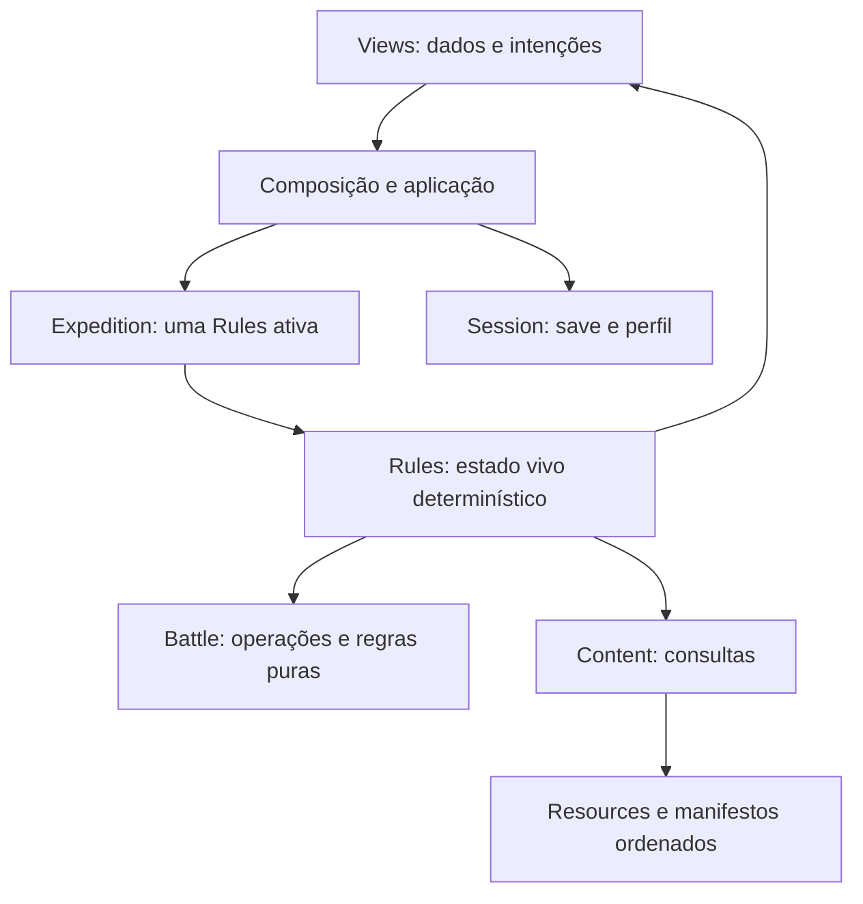

# Mapa de arquitetura e entrega paralela

Este mapa resume os contratos atuais; confirme a revisão com
`python tools/harness.py preflight --fetch` antes de planejar. Para regras de domínio,
veja [architecture.md](architecture.md); para comandos e evidência, [harness.md](harness.md).

## Caminho de uma ação

- `scripts/main.gd` compõe e conecta; `scripts/application/` reúne coordenação de
  aplicação. `session_runtime.gd` conecta os donos de sessão; `run_flow.gd` e
  `expedition_flow.gd` coordenam início, retomada e nós; `battle_turn.gd`,
  `battle_commands.gd` e `battle_interaction.gd` tratam o turno e seus comandos;
  `reward_flow.gd` coordena recompensas. Só main importa application; essa camada
  não importa main nem acessa armazenamento diretamente. UI, domínio e sessão não
  dependem dela.
- `scripts/expedition/expedition.gd` possui a Rules ativa e navega a expedição;
  `scripts/session/` é dona da persistência, com perfil separado do run.
- `scripts/rules.gd` possui o estado vivo. `scripts/battle/` recebe entradas explícitas
  para operações de combate: `encounter_setup.gd` inicializa encontros, `formation.gd`
  trata formação e substituição após KO, `battle_view.gd` projeta dados públicos e
  `round_aftermath.gd` resume descarte e resultado. Modelos em `scripts/domain/models/`
  validam snapshots destacados, sem criar um segundo estado mutável.
- `content/` é a fonte de espécies, formas, arestas, poderes, itens e encontros;
  `scripts/content.gd` oferece consultas. Evolução usa arestas explícitas, não estágio
  ordinal. Efeitos de itens têm handlers e schemas registrados.
- `scripts/ui/` recebe dados e emite intenções; views não guardam main nem alteram
  regras. `expedition_map.gd` mantém seleção, foco, layout e sinais da rota;
  `expedition_status.gd` apresenta formação, HP, inventário e aviso de save.
  `battle_surface.gd` apresenta a batalha; `screen_host.gd`, `battle_overlays.gd`,
  `menu_screens.gd` e `expedition_screen.gd` compõem telas. `input_router.gd` e
  `control_registry.gd` organizam entrada e foco; `browser_snapshot.gd` projeta dados
  públicos para a bridge. As telas de plano, revisão, diálogo e recompensa emitem
  intenções; `modal_frame.gd` constrói a moldura e `help_view.gd` apresenta ajuda.
- `assets/runtime-lock.json` fixa releases de arte. Retratos estáticos existentes não
  comprovam sprites animados nem arte final aprovada. `tools/harness_lib/registry.py`
  define tarefas, dependências e cobertura; o guard mede dívida, não prova comportamento.

A versão do produto continua 0.3.0. A aceitação automática não fecha diversão,
revisão humana de arte ou desempenho em hardware.

## Handoff seguro entre agentes

1. Faça preflight com fetch e leia status/diff, roadmap e contratos afetados. Compare
   a main remota e preserve mudanças existentes; combine o ponto de integração antes
   de editar arquivos compartilhados.
2. Divida por arquivos e responsabilidade. Cada arquivo tem um editor por vez; nomeie
   um integrador para `main.gd`, `rules.gd`, registro do harness, baseline e demais
   arquivos compartilhados. Outros agentes entregam interfaces, diffs e testes ao
   dono, sem sobrescrever trabalho alheio. Uma proposta de feature pode ser planejada
   em paralelo, mas deve declarar arquivos e contratos antes de editar.
3. Acorde sinais, dados, compatibilidade de save e dependências antes de conectar as
   frentes. Ao receber alterações concorrentes, leia o diff e integre os dois contratos;
   não restaure arquivos antigos nem regenere baseline para esconder regressão.
4. Execute primeiro os alvos afetados. Para aceitação, encerre edições, registre a
   revisão/estado das fontes e execute o grafo completo fresco; resultados focados,
   cacheados ou com fontes alteradas durante a execução não substituem esse fechamento.
   Registre falhas e limites junto dos resultados reais. Só depois retome edições.

Consulte [guidelines](architecture-guidelines.md) para restrições, autoria e
compatibilidade; [roadmap](roadmap.md) distingue trabalho planejado de concluído.
