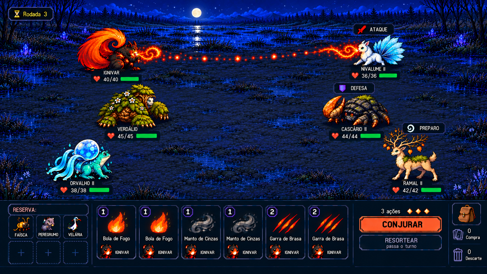

# Alvo visual aprovado para o MVP de batalha

O usuário confirmou este formato como objetivo do MVP de batalha. Decisão D31
do [roadmap](../../../roadmap.md). A imagem orienta a próxima implementação;
o executável atual permanece 0.3.0.

## Composição escolhida

- PC, 2D simples, câmera horizontal elevada e proporções que preservam a
  identidade das criaturas. Ambiente em escala coerente, chão discreto e espaço
  central para trajetória, impactos, proteção e outras animações.
- Até três ativos de cada lado, em grupos quase verticais e levemente curvos,
  sem ponta de triângulo marcada. Integrantes superiores e intermediários usam
  mais a parte alta do campo. Um ou dois ativos continuam opcionais.
- Corpos e apoios no mesmo chão, com silhuetas completas, rostos direcionados ao
  adversário e HP/intenção associados a cada dono. Recuos e cartas elevadas
  precisam conservar margem e legibilidade na implementação.
- HUD em quatro zonas, da esquerda para a direita: **reservas → cartas →
  ações/Conjurar/Resortear → mochila/compra/descarte**.
- Grade de reservas com três colunas e duas linhas à esquerda da mão. O time
  total continua limitado a seis. Neste exemplo há três ativos, três reservas
  reais e três células vazias; não são seis reservas adicionais. Sinais de mais
  são placeholders, sem ação de recrutamento ou expansão aprovada.
- Mochila única, pilhas distinguíveis, rodada discreta e ações junto de Conjurar.

## Alcance da aprovação

O formato visual está escolhido. D36 confirmou posteriormente a mão base de seis,
podendo aumentar ou diminuir por itens e Umbrals; prever acomodação de mãos
modificadas no HUD. Valores de HP/custo, nomes de estudos, novas formas e três
ações ilustram a cena; não fecham balanceamento ou catálogo. D39 define três
posições em linha, superior/central/inferior, sem retaguarda; destacar a máscara
dos poderes próprios e preservar a identidade das vagas com menos ativos. A
distância entre sprites não define alcance. Pivôs, espaçamento
exato e adaptação a um/dois ativos serão implementados e verificados em cena.

A [proposta de batalha](../../../battle-design-v0.4.md) continua sendo a referência
de regras. A [pauta da entrevista](../../../battle-interview-next.md) separa o
que falta decidir de valores que podem começar como hipóteses de protótipo.

## Origem e preservação

- [Evidência original](../../../../artifacts/battle-aligned-hud-20261017T194420Z/manifest.json), com prompt e revisão no mesmo diretório.
- [Catálogo central](../catalog.json): origem, dimensões, tamanho e SHA-256.
- Esta cópia mantém os bytes e metadados do PNG de origem.
- [Todas as referências](../README.md) · [Galeria](../index.html).
