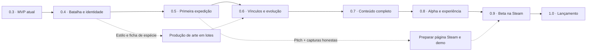

# Umbral: Ecos do Bosque — caminho até 1.0

Estado: **roadmap em desenvolvimento, com direções confirmadas e recomendações identificadas por status**, criado em 14/10/2026 a partir do MVP 0.3.0. As versões abaixo são marcos de produto, sem datas prometidas. Entregas futuras só ficam concluídas depois de implementadas e verificadas. A versão executável continua sendo 0.3.0.

**MVP técnico de batalha integrado:** a [primeira fatia coletiva](battle-implementation-v0.4.md) está integrada neste checkout, com HP individual, iniciativa por velocidade, alvos por vaga, ações, compra cíclica, trocas e HUD aprovado. A primeira validação integrada e a revisão visual estão registradas abaixo. A revisão de fundo/apoio V04-ART-06A também foi validada localmente após feedback do jogador. O [fechamento V04-BAT-04A/B](battle-closeout-v0.4.md) corrige captura/ciclo e acrescenta plano e histórico. Os critérios humanos do marco 0.4 continuam abertos.

Veja o [mapa visual interativo](roadmap.html), que funciona offline e contém todos os gráficos no próprio arquivo. Este documento é a fonte de verdade; atualize o mapa quando mudar versões, escopo ou critérios.

A [proposta detalhada de batalha v0.4](battle-design-v0.4.md) desenvolve HP individual, ações, compra, itens e a composição selecionada. Parcial confiável é o padrão escolhido; o [contrato configurável](intent-visibility-design.md) separa os três níveis do plano da IA e o [estudo](enemy-information-study.md) compara cenários. A [direção de criaturas](creature-identity.md) desenvolve identidades próprias. O comportamento do MVP continua documentado separadamente.

**Alvo visual do MVP de batalha aprovado em D31:** [horizontal elevada, formação quase alinhada e HUD em quatro zonas](references/battle/00-aprovada/README.md). As 41 imagens estão no [acervo central](references/battle/README.md) e na [galeria local](references/battle/index.html). D36/D37 fecham mão base seis modificável, repertório inicial, reposição gratuita e reanimação para agir na próxima rodada. A [pauta atualizada](battle-interview-next.md) separa essas decisões do detalhamento restante; o executável segue 0.3.0.

## Visão e diagnóstico

**Forme vínculos com criaturas de um bosque que perdeu suas memórias. Monte um time durante cada expedição, combine os poderes dele e transforme esse vínculo em evolução.** A identidade proposta é um roguelike de formação de equipes e cartas de poderes, com batalhas de conjuração simultânea. A inspiração em combinações deve servir a essa identidade.

O repositório já entrega:

- Godot 4.6.3 / GDScript, menu, batalha, opções, inspeção, recompensas e conclusão.
- Quatro espécies iniciais: Brasa → Ignivar, Musgo → Verdálio, Faísca → Tempestral e Orvalho → Marevéu; oito formas e cinco passivas individuais.
- Expedição com bifurcação fixa, chefe e save/continuar exato; treino conserva os três encontros em sequência. Cartas com dono, captura, evolução e formação explícitas.
- HUD em quatro zonas, sprites/arena originais, comandos visíveis, histórico da rodada, feedback audiovisual e opções de acessibilidade.
- Harness de regras, mutações, cena real, navegador, matriz de telas e CI com pacotes Web, Windows e Linux.

As lacunas principais são **profundidade das decisões de batalha, uma expedição com escolhas de rota, identidade narrativa/artística consistente e variedade de combinações**. O mapa inicial tem uma bifurcação fixa e save de expedição; ainda não há geração procedural ampla, loja, relíquias adquiríveis, eventos variados ou Steamworks. O grimório atual é uma base de interface, não uma coleção narrativa completa.

O CI [38632485628](https://github.com/peguidotte/umbrals/actions/runs/38632485628) aprovou o código `74df8de`. Isso comprova as etapas automatizadas executadas. Diversão, legibilidade para alguém novo, Windows em execução, controle físico e integração Steam precisam de evidência própria.

## Backstory proposta

Na **Noite da Fenda**, o coração do bosque se partiu. As lembranças que ligavam seus habitantes se espalharam, e os antigos guardiões passaram a repetir fragmentos do passado. Os Umbrals nasceram desses vínculos entre memória e natureza: uma brasa preservada, uma raiz que protegeu alguém, uma tempestade que nunca terminou.

Você é um **Guia de Ecos**, capaz de ouvir essas lembranças. Parte do Refúgio para reconectar três santuários e descobrir por que o **Rei sem Aurora**, já presente no MVP, mantém a floresta presa àquela noite. Cada expedição reorganiza caminhos e encontros. Umbral vencido pode ter seu vínculo restaurado e se juntar ao time.

O trait expressa a natureza da espécie; a passiva individual representa uma marca de sua história; evoluir significa recuperar uma memória e assumir uma nova forma. Fragmentos curtos aparecem em encontros, eventos, evolução e códice. O desfecho resolve o conflito principal da versão 1.0.

Tom: mistério acolhedor, criaturas marcantes e melancolia com esperança. Floresta noturna, ritual botânico, pergaminho, ouro envelhecido e cores elementais seguem a direção visual existente. Esta sinopse e os nomes novos são propostas de trabalho, sem substituir o conteúdo atual.

## Decisões que orientam o projeto

| ID | Diretriz | Marco / estado |
|---|---|---|
| D01 | Time montado em cada run; códice e desbloqueios permanentes. Indivíduos capturados e suas evoluções pertencem à expedição. | **Confirmada pelo usuário em 14/10/2026.** Orienta os saves da v0.5 e a progressão da v0.6. |
| D02 | Combate coletivo; começa com um, até seis no time e de um a três ativos por escolha. | **Formação confirmada pelo usuário.** 1 ativo + 5 reservas contra 3 inimigos é legal; não auto-preencher campo ou reduzir ações por ter menos ativos. Implementado na primeira fatia coletiva do working tree; a release 0.3 anterior não tinha reservas/HP individual. |
| D03 | Conjuração com regras de ordem predefinidas, independente dos cliques. Ações são o único recurso de execução, com custos variáveis. | **Recurso único confirmado.** D38 acrescenta iniciativa por velocidade individual; fases globais eram proposta. Três ações do grupo permanecem hipótese inicial sugerida; mão base seis definida em D36. Não é uma ação obrigatória por ativo. |
| D04 | Evolução durante a run, uma por espécie, preservando UID/passiva e abrindo poder de assinatura. | Condições e benefícios definidos na v0.6. |
| D05 | Desktop, Windows como plataforma primária; Linux acompanhado de validação própria. Web serve como demonstração e harness. PT-BR + inglês. | Base v0.4; execução Windows e localização completas até v0.8. |
| D06 | Hipótese inicial de oito espécies / dezesseis formas / três biomas. Arte 2D simples, orientada por D16, com animação por poses e efeitos legíveis. | Orçamento de conteúdo a fechar até v0.6; composição 1 escolhida como base, refinamento de câmera/apoio no chão em revisão. |
| D07 | Equilibrar criaturas marcantes e combinações surpreendentes como promessa central da experiência. | **Confirmada pelo usuário em 14/10/2026 na oficina de direção.** Orienta batalha, captura, evolução e construção de builds desde as primeiras fases. |
| D08 | Remover expansores de campo: nenhum item, relíquia ou espécie aumenta o teto de três ativos. | **Nova direção do usuário**, substituindo o modelo de até seis simultâneos. Time total até seis; relíquias podem explorar orçamento de ações, ainda como proposta. |
| D09 | Itens permitem remover cartas de golpes durante a run, enxugando e organizando o baralho. | **Direção confirmada pelo usuário em 14/10/2026.** Remover uma cópia ou esquecer todas, custos e limites estão em discussão. |
| D10 | HP individual para viabilizar alvos, ataques em área, provocação, proteção de especialistas e reanimação. A 0 HP, incapacitar e permitir reanimar; resgatar/sepultar fica para uma escolha posterior. | **Modelo de HP desenvolvido a partir da direção do usuário; consequência de 0 HP confirmada na resposta.** Não tratar nocaute como morte definitiva automática. |
| D11 | Resortear a mão custa um turno inteiro, sem realizar ações de combate; o inimigo executa a intenção anunciada. | **Custo de turno confirmado pelo usuário.** Resolve a intenção normal, sem taxa artificial de dano; compra cíclica confirmada em D14. |
| D12 | Consumíveis externos, relíquias globais e artefatos individuais, todos fora do baralho. | **Categorias e separação confirmadas pelo usuário.** Quantidades de slots e custos de uso continuam hipóteses de teste. Artefatos não acrescentam cartas de item ou poderes temporários por simples equipamento. |
| D13 | Sem teto fixo de cartas/ações por Umbral; chefes podem punir repetições de maneira anunciada, preservando respostas para runs solo. | **Confirmada pelo usuário na rodada atual.** Teto base de duas cartas e sobretaxa de repetição não foram escolhidos. |
| D14 | Pilha de compra e descarte visíveis; renovar a mão ao fim do turno e reembaralhar o descarte apenas ao esgotar a pilha. | **Confirmada pelo usuário na rodada atual.** Reembaralhamento completo com pesos e mão persistente ficaram como alternativas não escolhidas. |
| D15 | Máximo de três adversários ativos, alinhado ao teto 3×3. | **Direção solicitada nesta rodada.** Não exige três inimigos em todo encontro ou acrescenta reservas da IA. |
| D16 | 2D simples; conceitos 1 (triângulos) e 3 (diagonal) escolhidos para aprofundar. Câmera elevada, chão, corpos variados e HUD compacto; PC apenas nesta etapa. | **Seleção explícita do usuário.** Na diagonal, sprites inteiros precisam se encarar no eixo do confronto. Variações de cenário, Umbrals e ataques solicitadas; artes novas são exploratórias. |
| D17 | O baralho contém somente poderes, sempre com dono; novos poderes podem ser comprados, trocados, aprendidos ou evoluídos por um caminho próprio de progressão. Itens permanecem externos. | **Direção confirmada pelo usuário.** Compatibilidade definida em D18; efeito sobre cópias e custos continuam em design. |
| D18 | Poderes universais, por natureza (Fogo, Raio etc.) e por espécie/linhagem. Uma técnica da espécie pode evoluir com suas evoluções. | **Confirmada pelo usuário.** Definir catálogo e requisitos sem transformar essa classificação automaticamente numa tabela de vantagens elementais. |
| D19 | Cartas de Umbral incapacitado permanecem na mão e no ciclo, bloqueadas para uso; não são retiradas da compra nem repostas gratuitamente. | **Confirmada pelo usuário, substituindo a recomendação anterior de reserva.** Fim de turno descarta/renova a mão conforme D14; passar/resortear custa o turno. |
| D20 | Lojas entre runs para aprender/evoluir técnicas, além dos mercadores de expedição já propostos. | **Direcionamento do usuário.** Tratar como loja do Refúgio; persistência de desbloqueios, melhorias de força ou preparação da próxima run está em entrevista. D01 não foi revogada. |
| D21 | **Parcial confiável por padrão**; suportar oculto/parcial/completo como apresentações configuráveis do mesmo plano pré-calculado da IA. | **Direção confirmada pelo usuário.** Disponibilidade, vigência da troca e eventual progressão de ajuda continuam em entrevista. Prévia não revela dados ocultos. Ver [contrato](intent-visibility-design.md). |
| D22 | Batalha com teto 3×3 escolhida; ocupar um, dois ou três lugares é opcional, com até seis integrantes no time. | **Confirmado pelo usuário**, incluindo 1×3 e cinco reservas. Não criar obrigação de completar trio. Troca/entrada/retirada e cartas de reserva continuam em design. Ver [direção](battle-3v3-direction.md). |
| D23 | Combinações causais e ordem de execução predefinida, como água → Encharcado → golpe elétrico ampliado. | **Direção confirmada pelo usuário.** D38 passa a reger a iniciativa por velocidade; a ordem dos cliques não altera o resultado. Água precisa preceder raio na execução para aproveitar a marca. Preparação sempre antes de impacto era proposta, agora histórica. |
| D24 | Mochila única para acessar itens e informação de rodada/ações mais compacta. | **Direção confirmada pelo usuário.** Proposta: rodada no canto, ações junto de Conjurar, itens num painel externo aberto pela mochila. Sem implementação. |
| D25 | Três ações compartilhadas como base de teste; possíveis ampliações por relíquias, mantendo três ativos. | **Hipótese sugerida pelo usuário, sem números finais.** Testar efeitos condicionais e permanentes; não transformar cada ativo em uma ação exclusiva ou a relíquia em requisito de vitória. |
| D26 | Referência atual: diagonal do pântano frio. Gerar 1×1/2×2/3×3 com câmera, escala por espécie, HUD e regra de disposição consistentes. | **Pedido explícito do usuário.** Centros dos times e passo regular guiam os apoios; ocupação não causa zoom ou posições arbitrárias. Ver [brief de layout](battle-layout-diagonal.md). |
| D27 | Comparar 3×3 de evoluídos grandes na diagonal e na horizontal, após concluir a série de ocupação. | **Pedido explícito do usuário.** Testar largura/altura/caudas das mesmas famílias com arena e HUD estáveis. Formas evoluídas são estudos, sem aprovar catálogo ou atributos. Ver [estudo de escala](battle-layout-diagonal.md#estudo-de-escala-dos-evoluídos). |
| D28 | Comparar câmeras e disposição, articulando preferência estética pela diagonal e hipótese de maior fluidez horizontal. | **Exploração solicitada pelo usuário.** [Estudo de câmera](battle-camera-study.md) compara horizontal elevada, diagonal alta e horizontal lateral. Horizontal elevada foi a recomendação inicial da IA, posteriormente selecionada como referência visual em D29; ângulos são guias de arte. |
| D29 | Horizontal elevada refinada escolhida como base visual; diminuir um pouco os Umbrals e fechar/regularizar os dois trios. | **Seleção explícita do usuário.** Manter a câmera selecionada, proporções adultas e texto legível; mais margem para golpes/animações. Variações de HUD autorizadas como exploração, ainda sem seleção. Ver [refinamento](battle-camera-study.md#refinamento-selecionado--rm-battle-16). |
| D30 | Escala menor para o cenário; formação quase reta com leve curvatura e integrantes superiores/intermediários mais altos. HUD: reservas à esquerda em grade 3×2, cartas, ações/Conjurar/Resortear e utilidades na extrema direita. | **Direção explícita do usuário**, substitui triângulos e a recomendação de barra inferior. Interpretar a grade como seis células visuais; neste 3×3 são três reservas reais e três vazias. Time máximo seis permanece. Ver [direção atual](battle-camera-study.md#direção-atual--rm-battle-17). |
| D31 | Formato D30 aprovado como alvo visual do MVP de batalha; reunir e organizar todas as imagens de referência. | **Confirmado pelo usuário.** Referência canônica em [00-aprovada](references/battle/00-aprovada/README.md), 41 PNGs em 12 etapas no [acervo](references/battle/README.md), com galeria e catálogo de origem/hashes. Aprovação visual não fecha números de cartas, balanceamento ou catálogo; regras restantes seguem na [pauta de entrevista](battle-interview-next.md). |
| D32 | Cartas de reservas aptos ficam fora das zonas e do embaralhamento ativos; não são compradas. | **Confirmado pelo usuário.** Preservar instâncias/melhorias fora do ciclo ativo. D19 continua para incapacitados, sem limpar penalidade ao repor a vaga. Detalhar a transição sem compra/filtragem gratuita. |
| D33 | Cada troca voluntária custa uma ação e só executa ao confirmar Conjurar, junto da resolução do turno. | **Confirmado pelo usuário.** Selecionar apenas planeja; cancelar não troca, compra ou sorteia. Na aceitação posterior das recomendações, quem entra contribui a partir da próxima compra normal. Fase de manobra e algoritmo de reinserção permanecem propostas. |
| D34 | Proposta anterior de mão oito, três poderes iniciais por dono com duas cópias cada, mantendo três ações como hipótese. | **Histórico: mão oito substituída por D36; repertório inicial aceito.** Exemplo de dupla específica em 18 cartas: 29,9% na mão seis e 48,0% na oito, sem comprovar diversão. Ver [estudo](battle-design-v0.4.md#cartas-por-captura-mão-e-consistência). |
| D35 | Default de configuração do MVP: três modos de informação disponíveis inicialmente, parcial padrão, mudança aplicada ao próximo plano/turno e sem reduzir ajuda automaticamente por progresso. | **Inicialmente adotado por delegação; ratificado na aceitação das recomendações.** D21 já definia os níveis sobre a mesma IA e pedia configuração durante a partida. Não reabrir esse modelo amplo; ver [contrato](intent-visibility-design.md). |
| D36 | Mão base seis, podendo aumentar ou diminuir por itens e Umbrals. Repertório inicial de três poderes com duas cópias por dono. | **Ajuste explícito do usuário para seis e modificadores; demais recomendações aceitas.** Substitui a mão oito de D34. Sem extras: 6/12/18 cartas para 1/2/3 ativos aptos; mão base seis nos três casos. Aprender adiciona/substitui; evoluir melhora cópias existentes sem inflar automaticamente o baralho. Não muda ações ou o teto de três ativos. Timing/limites dos modificadores continuam em protótipo. |
| D37 | Reposição após nocaute gratuita entre rodadas, após toda a resolução (fila dos dois lados com D38). Reanimar nesta rodada e agir na próxima. | **Recomendação de reposição aceita e timing de reanimação explicitamente escolhido.** Troca voluntária continua custando uma ação. Não preencher o trio obrigatoriamente nem limpar as cartas bloqueadas de D19. Custos/HP dos efeitos de reanimação e transições fora do campo ainda precisam de detalhamento. |
| D38 | Ordem de atuação baseada na Velocidade individual dos Umbrals, com atributos próprios. | **Escolha do usuário**, em vez de toda a conjuração do jogador antes da resposta inimiga. Fila por poder, exceções explícitas de prioridade, trocas prioritárias e desempates estáveis são defaults propostos por delegação. Catálogo/fórmulas dos atributos não foram fechados. Não garantir combos contra a iniciativa ou interrupções. |
| D39 | Linha de três posições por lado, sem retaguarda. Golpes individuais, superior + central, central + inferior ou todas. | **Definição explícita do usuário.** Posições importam para alcance, sem criar cobertura por fileiras. Identidades das vagas permanecem estáveis com ocupação parcial; ajustes entre encontros e vagas vazias são detalhamento proposto. |
| D40 | O substituto recebe o golpe destinado à vaga do integrante que saiu. | **Confirmado pelo usuário.** Trocar não cancela automaticamente o ataque nem recalcula a escolha da IA. Preservar o plano comprometido e respeitar a projeção oculto/parcial/completo. |
| D41 | Reações como centro do combate, com resistências pontuais e visíveis por espécie. | **Confirmada pelo usuário, opção A.** Sem tabela universal de vantagens por tipo. Percentuais e catálogo são defaults de protótipo, separados da direção aprovada. Ver [especificação](natures-status-reactions-v0.4.md). |
| D42 | Uma natureza principal e secundária apenas em espécies/formas específicas. | **Confirmada pelo usuário, opção A.** Segunda natureza não é obrigatória em toda espécie/evolução, não concede resistência ou cartas extras automaticamente e não altera UID/passiva. |
| D43 | Controle principalmente por enfraquecimento e iniciativa, preservando respostas e runs solo. | **Confirmada pelo usuário, opção A.** Desenvolver redução da potência do próximo ataque e alterações de Velocidade na próxima fila; interrupções específicas exigem regra explícita. Perda universal de turnos não é padrão de Raio/Gelo. |
| D44 | Captura permite escolher Campo ou Reserva, sugerindo uma vaga livre. | **Confirmada em 29/10/2026, opção recomendada.** Confirmar envia ao destino; voltar preserva o sorteio. Capturar no campo entre encontros não custa ação, não preenche as outras vagas e não elimina runs solo. Ver [revisão](battle-closeout-v0.4.md). |
| D45 | Reduzir texto permanente, ampliar comunicação por imagens e dar identidade própria ao HUD, cores e mapa. | **Direção explícita do usuário** após RM-UX-28. Retratos, arte de poderes e mapa ilustrado são propostas de execução; paleta específica ainda deve ser vista em composição. [Direção e critérios](ux-polish-next.md). |

D01 está definida: cada nova expedição monta um novo time a partir das possibilidades desbloqueadas. Códice e desbloqueios ficam no perfil permanente; capturas e evoluções daquele time ficam no estado da run. **Retomar uma expedição salva mantém os mesmos indivíduos, passivas, evoluções e progresso**, sem iniciar outro time. O save deve separar perfil permanente e expedição em andamento. Os desbloqueios específicos ainda serão desenhados nos marcos correspondentes.

## Oficina de direção

**RM-PLAN-03 · 14/10/2026 · proposta para discussão.** O usuário pediu aprofundar o planejamento por fases, dar os direcionamentos principais e delegar o preenchimento das lacunas com inspiração em PokéRogue, Pokémon, Balatro e outros roguelikes estratégicos. A ambição é uma experiência de destaque, com identidade, profundidade e acabamento. As fases abaixo organizam essa conversa; correspondem aos marcos existentes e não confirmam novas mecânicas, quantidades ou datas.

**Direção confirmada — D07:** equilibrar criaturas marcantes e combinações surpreendentes. Interpretação de trabalho: **criaturas memoráveis cujas combinações transformam a estratégia de cada expedição**. Capturar muda as possibilidades do time; evoluir abre decisões; construir uma combinação faz o jogador reconhecer a própria descoberta. Os exemplos e sistemas que concretizam essa direção continuam propostos. D01 também continua confirmada.

Pilares propostos a partir de D07:

1. **Identidade que se joga.** A fantasia de uma criatura aparece em seu trait, seus poderes, sua evolução e sua apresentação. Critério: o jogador consegue explicar por que ela importa naquele time.
2. **Combinações que transformam escolhas.** Uma interação relevante muda o valor de um poder, de uma captura ou de uma rota. Critério: o jogador reconhece o que preparou e por que o resultado aconteceu.
3. **Adaptação durante a expedição.** As ofertas permitem continuar um plano, ajustá-lo ou assumir uma nova direção com concessões compreensíveis. Critério: partidas diferentes dão motivos para decisões diferentes.
4. **Consequências claras e momentos marcantes.** Intenções, custos e gatilhos podem ser entendidos antes da confirmação; conjurações e evoluções expressam sua importância. Critério: o espetáculo comunica a estratégia e mantém o ritmo de jogo.

As fases 1 e 2 já precisam testar os dois lados de D07 com o elenco pequeno. A fase 3 amplia e aprofunda uma promessa que começou a ser demonstrada; não deve ser o primeiro momento de procurar uma combinação transformadora.

### O que buscar nas referências

| Referência | Princípio que vamos investigar | Aplicação candidata ao Umbral |
|---|---|---|
| **Pokémon** | Identidade das espécies, apego ao indivíduo e expectativa de evolução. | Silhueta, comportamento, trait e poderes contam a mesma fantasia; duas capturas da mesma espécie podem sugerir planos diferentes. |
| **Palworld** | Criaturas reconhecíveis com jeito próprio e presença no mundo, referência solicitada pelo usuário. | Hábitos, proporções e reações dão personalidade além do elemento; não copiar espécies ou assets. |
| **PokéRogue** | Formação do time dentro da run, adaptação a encontros e possibilidades iniciais desbloqueadas. | A oportunidade de captura disputa valor com fortalecer o time atual; um desbloqueio convida a outra expedição. |
| **Balatro** | Poucas regras legíveis que permitem combinações surpreendentes; economia e preparação para desafios. | Relíquias e passivas podem alterar o valor de poderes e composições. Uma build excepcional exige preparação e concessões; a interface explica a cadeia de efeitos. |
| **Slay the Spire** | Rota, recursos, consistência do baralho e adaptação ao que a run oferece. | Capturar, treinar, evoluir, comprar e descansar competem por oportunidades; o jogador consegue preparar respostas para ameaças anunciadas. |
| **Into the Breach** | Informação antecipada e consequências táticas compreensíveis. | Intenção e prévia permitem ponderar alternativas; novos padrões inimigos exigem respostas diferentes. |
| **Pirates Outlaws** | Expedição, baralho e combinações; leitura parcial lembrada pelo usuário. | Explorar intenção por categoria e respostas sob incerteza. Fonte oficial e limite da verificação no [contrato de informação](intent-visibility-design.md#pirates-outlaws). |
| **Monster Train** | Especialização e interações entre partes de uma composição. | Um trio ativo com reservas pode concentrar recursos em um protagonista, combinar uma dupla ou distribuir participação, sem obrigar todos a usar poderes em cada jogada. |

Essas aplicações são hipóteses para prototipar. Por exemplo, a leitura de Balatro não obriga o jogo a usar pontuação de pôquer, multiplicadores ilimitados ou ordenação manual de cartas. A conjuração atual continua simultânea e independente da ordem dos cliques.

### Fases para orientar a produção

| Fase / marco | Experiência que queremos construir | Direcionamento principal do usuário | Lacunas que a IA desenvolve a partir dele | Evidência para avançar |
|---|---|---|---|---|
| **0 · Visão e pilares · planejamento** | Uma promessa reconhecível para explicar por que alguém escolheria Umbral. | Fantasia central, peso das referências, tom e público pretendido. | Pilares, vocabulário, exemplos de decisões, restrições e mapa de hipóteses. | Exemplos de captura, batalha e evolução expressam a mesma promessa; prioridades registradas. |
| **1 · Batalha e identidade · 0.4** | Uma batalha que sustenta decisões interessantes com o elenco atual. | Papel do time, sensação da conjuração e grau de informação/complexidade. | Padrões inimigos, alternativas ofensivas/defensivas e um pequeno experimento de sinergia que mude uma decisão; explicação dos resultados e uma família visual de referência. | O jogador compreende as consequências, identifica o papel das criaturas e encontra motivos para mudar a jogada conforme a ameaça e a combinação disponível; critérios humanos e técnicos da 0.4 cumpridos. |
| **2 · Expedição e construção da run · 0.5** | Uma sequência de escolhas em que a run começa a ganhar uma identidade própria. | Ritmo, tensão, liberdade de rota e papel da captura. | Mapa, ofertas, moeda, mercador, descanso, eventos, primeiras relíquias, chefe e salvar/continuar. | Capturar, especializar e preservar recursos apresentam concessões compreensíveis; ganhar, perder e retomar funcionam. |
| **3 · Criaturas, evolução e combinações · 0.6** | Times diferentes transformam o modo de jogar; evoluções são momentos esperados. | Identidade das famílias e importância de indivíduos, especialização e evolução. | Fichas de espécies, passivas úteis, requisitos de evolução, poderes, treino, relíquias e interações entre famílias. | Composições com planos distintos são jogáveis; evoluir muda decisões; combos fortes têm preparação e regras explicáveis. |
| **4 · Mundo, progressão e rejogabilidade · 0.7** | Completar uma expedição dá vontade de iniciar outra com um plano novo. | Promessa de longo prazo, peso da história, descoberta e desafio após a primeira vitória. | Biomas/chefes, eventos, códice, desbloqueios e orçamento de conteúdo; propor modificadores de dificuldade e desafios para avaliação. | Run completa com desfecho; desbloqueios abrem possibilidades; novas composições e encontros sustentam diferenças entre partidas. |
| **5 · Experiência completa · 0.8** | Entrar, entender, jogar e voltar com conforto e personalidade visual/sonora. | Referências de acabamento, intensidade dos efeitos e experiência desejada no controle. | Onboarding, inspeção, comparação de recompensas, acessibilidade, localização, remapeamento, áudio e desempenho. | Primeiras sessões sem orientação verbal e validação real de Windows/controle/hardware, além dos critérios da alpha. |
| **6 · Demo e beta · 0.9** | Uma amostra representativa apresenta a promessa do produto e convida a continuar. | Recorte da demo, posicionamento e público prioritário para os testes. | Percurso da demo, plano de playtests, materiais reais de loja, prioridades de correção, instalação e atualização. | Pessoas externas entendem o diferencial; problemas observados orientam ajustes; distribuição e saves passam pelo fluxo Steam previsto. |
| **7 · Lançamento e continuidade · 1.0** | A promessa apresentada na demo se cumpre em uma experiência completa e estável. | Critério comercial de lançamento e ambição da continuidade. | Preparação da candidata, compatibilidade de saves, suporte, notas e prioridades de correção; propostas posteriores separadas do compromisso 1.0. | Critérios dos marcos cumpridos, versão e loja aprovadas e publicação autorizada. |

Arte, áudio, clareza, acessibilidade e playtest acompanham todas as fases. A fase 5 consolida o padrão do conjunto. A fase 0 é uma conversa de direção que passa a orientar as fatias; não é um novo número de versão nem depende de recomeçar o projeto.

### Questões de design que merecem protótipo cedo

1. **Captura e consistência do baralho.** Cada indivíduo começa com duas cópias de três poderes; a evolução melhora as instâncias existentes sem acrescentar assinaturas automaticamente. Assim, adicionar um membro amplia possibilidades e dilui a frequência das cartas anteriores. D09 confirma a direção de remoção por itens para construir consistência. O alcance da remoção e eventuais alternativas de treinamento continuam propostos. A escolha de criaturas deve continuar determinando os donos dos poderes.
2. **Especialização e cooperação.** O trait de Faísca e reações como Encharcado + raio incentivam cooperação. A batalha coletiva não concede bônus genérico por selecionar três donos. Precisamos comparar seus benefícios com planos centrados em um ou dois indivíduos para evitar que toda build procure a mesma jogada. Não presumir que uma tabela maior de elementos resolverá isso.
3. **Poder de uma evolução.** O estado atual melhora atributos e técnicas conhecidas; assinaturas são opções de aprendizado, sem cópias extras automáticas. Investigar assinaturas ou interações que criem uma nova decisão, preservando UID e passiva. O valor esperado e o custo de acrescentar cartas precisam ser avaliados juntos.
4. **Liberdade das combinações e pressão inimiga.** Permitir que uma build preparada seja muito forte faz parte da hipótese de diversão. Avaliar requisitos, custos, frequência e respostas possíveis dos inimigos. Regras de gatilhos, resolução e eventual repetição devem ser explícitas, determinísticas e coerentes com a prévia; loops acidentais são defeitos.
5. **Progressão permanente e descoberta.** D01 estabelece códice/desbloqueios e um novo time por run. Desenvolver propostas de novas possibilidades iniciais, espécies e desafios; comparar o incentivo à descoberta com o risco de tornar vitórias dependentes de repetição obrigatória para ganhar atributos.

O alvo atual de oito espécies / dezesseis formas / três biomas é uma hipótese de orçamento, não um teto de ambição nem uma contagem aprovada pelo usuário. O tamanho final será discutido à luz de papéis estratégicos, combinações, produção de arte e playtest. Cada expansão deve acrescentar decisões reconhecíveis.

### Como vamos trabalhar juntos

Para cada fase, o usuário dá uma direção curta: **o que o jogador deve sentir, o que precisa existir e quais escolhas autorais importam**. A IA devolve uma proposta completa com experiência, sistemas, conteúdo, exemplos, dependências, critérios e primeiras fatias jogáveis.

Usar a skill local [`umbral-design-interview`](../.agents/skills/umbral-design-interview/SKILL.md), inspirada em [Grill Me / grilling](https://github.com/mattpocock/skills/tree/49dd158d1076134a641b33efb035946536778336/skills/productivity/grilling). As perguntas vêm em blocos de decisões independentes, cada uma com opções distintas, recomendação, base em referências e concessão. O usuário autorizou desenvolver recomendações e preencher lacunas; detalhes adotados por delegação devem ser identificados dessa forma. Pergunta sem resposta continua pendente, sem virar aprovação automática.

Detalhes coerentes com uma direção já estabelecida podem ser desenvolvidos autonomamente e registrados como hipóteses. Mudanças na fantasia central, no contrato de batalha, na progressão permanente, na plataforma ou no orçamento são apresentadas como decisões de produto em aberto. Não pedir ao usuário que defina números ou microdecisões que a própria proposta pode resolver. Distinguir **confirmado**, **proposto** e **verificado no jogo** em cada revisão; um sistema pode estar implementado e ainda exigir playtest.

### O que as skills locais cobrem

- [`umbral`](../.agents/skills/umbral/SKILL.md): fatias observáveis, contratos do projeto, evidências e manutenção deste roadmap.
- [`card-game`](../.agents/skills/card-game/SKILL.md): zonas, compra, consistência, recursos e resolução de efeitos; a referência de efeitos orienta futuros gatilhos e interações.
- [`game-ui-ux`](../.agents/skills/game-ui-ux/SKILL.md) + [`godot-ui-control`](../.agents/skills/godot-ui-control/SKILL.md): informação de batalha, comparação, navegação e telas que suportam a complexidade proposta.
- [`game-feel`](../.agents/skills/game-feel/SKILL.md) + [`godot-animation`](../.agents/skills/godot-animation/SKILL.md): conjurações, capturas e evoluções com feedback proporcional e legível.
- [`create-game-assets`](../.agents/skills/create-game-assets/SKILL.md): famílias visuais coerentes e produção validada dentro do jogo.
- [`audio-design`](../.agents/skills/audio-design/SKILL.md) + [`godot-audio`](../.agents/skills/godot-audio/SKILL.md): identidade sonora, mixagem e música que pode acompanhar a tensão da run.
- [`input-systems`](../.agents/skills/input-systems/SKILL.md): ações, controle, remapeamento e acessibilidade.

São onze skills: nove de gamedev registradas no lock de origem e dois workflows locais, `umbral` e `umbral-design-interview`. Elas apoiam execução, entrevista e revisão. **Design de economia roguelike, matriz de sinergias, progressão e análise de balanceamento ainda precisam de propostas e critérios específicos do Umbral**; citar uma skill não preenche essas decisões nem comprova qualidade.

## Batalha recomendada

O objetivo é escolher **como aquele time resolve a intenção anunciada**, com poucos comandos e consequências legíveis.

**Direção implementada:** [batalha 3×3](battle-3v3-direction.md): um integrante inicial, até seis no time e três ativos como teto fixo de cada lado, com ocupação aliada opcional de um a três. Expansores de campo saem da proposta. Três ações compartilhadas passam a hipótese inicial; relíquias podem ampliá-las sem acrescentar corpos. HP individual, intenção parcial e itens externos continuam. O produto continua 0.3.0, com as fatias coletivas integradas neste checkout.

Detalhes, exemplos, alternativas e limites estão na [proposta de batalha](battle-design-v0.4.md). Abaixo, o contrato atual serve de referência de migração, sem definir silenciosamente as regras futuras.

### Contrato da batalha implementada

As fatias coletivas, táticas, elementais e de fechamento V04-BAT-04A/B já estão
no working tree, mantendo a versão de produto 0.3.0. O contrato técnico está em [arquitetura](architecture.md)
e a [revisão tática](battle-tactics-review-v0.4.md) registra o escopo verificado.

1. Mão base seis e três ações compartilhadas; poderes têm custos e donos.
   Reservas aptas não entram na compra; cartas de incapacitados permanecem
   bloqueadas no ciclo. Até três ativos por escolha e seis no elenco.
2. Aliados e inimigos se intercalam por prioridade/Velocidade. O plano inimigo
   é comprometido antes das escolhas, com projeções oculto/parcial/completo.
   Não há limite arbitrário de sete rodadas.
3. O jogador planeja poderes, alvos, trocas e itens, revisa/remove comandos e
   confirma com Conjurar. Resortear passa a rodada inteira, incluindo inimigos.
4. Cada Umbral tem HP/escudo próprios. Trocas custam ação; quem entra recebe o
   golpe destinado à vaga e contribui cartas na próxima compra normal.
5. Encharcado + golpe elétrico já dobra potência elétrica se a condição existir
   na execução. Semeado + Bosque/Água/Fogo concede escudo/cura/Queima;
   Interferência enfraquece o próximo ataque sem retirar o turno. Queima,
   Provocar e Carga funcionam; não há tabela universal de vantagens por tipo.
6. Captura escolhe Campo/Reserva; PLANO mostra os comandos próprios e RESUMO
   explica a última rodada. Reinserção e recuperação seguem o [contrato atual](battle-closeout-v0.4.md).

O antigo bônus Vínculo triplo de +6 e a resolução inteira do jogador antes do
inimigo pertencem ao MVP anterior à batalha coletiva. Não aplicar essas regras
como comportamento atual. Naturezas e reações implementadas estão na
[especificação validada](natures-status-reactions-v0.4.md). Efeitos novos precisam de timing, limites e testes explícitos.

### Equipe ampliável e edição do baralho

| Tema | Recomendação inicial | Por quê / estado |
|---|---|---|
| **Capacidade do time** | Até seis integrantes; de um a três ativos por escolha e de cinco a três reservas na equipe cheia. | **Implementado.** Seis vagas disponíveis, um integrante inicial; não forçar três ativos. |
| **Expansores** | Sem expansão do campo. Relíquias podem explorar ações adicionais. | **Campo fixo em três.** Efeitos de ações, condições e empilhamento ainda em protótipo; não abrir quarto ativo. |
| **Mão e conjuração** | Mão base seis, aumentada/reduzida por itens e Umbrals. Repertório inicial de três poderes × duas cópias por dono. | **Confirmado em D36.** Três ações do grupo permanece hipótese; custos variáveis, sem energia separada. Modificar mão não concede ações; liberdade de concentrar poderes num dono permanece. |
| **Participação por indivíduo** | Sem teto fixo por dono; chefes podem anunciar uma punição por repetição, com possibilidade de proteção/adaptação. | **Confirmado pelo usuário.** Mantém runs solo possíveis; não bloquear uma composição legal sem resposta disponível. |
| **Iniciativa** | Velocidade individual ordena a atuação dos dois lados; cliques não escolhem a ordem. | **Confirmado em D38.** Prioridades especiais, desempates e atualização de velocidade dentro da rodada são defaults de protótipo. Preparar água antes de raio depende da ordem efetiva. |
| **Posições e alcance** | Superior, central e inferior por lado, sem retaguarda; técnicas individuais, em duas posições adjacentes ou em todas. | **Confirmado em D39.** Layout preserva a referência aprovada e comunica as vagas; a distância visual não altera alcance. |
| **Vida e alvos** | HP individual, ataques individuais/em área, provocação explícita e reanimação; até três adversários ativos. | **Direção de design atual.** O usuário confirmou nocaute reversível e escolha posterior de resgatar/sepultar; 0 HP não é morte permanente automática. |
| **Cartas de incapacitados** | Manter na mão, pilha e descarte, bloqueadas enquanto o dono estiver caído. | **Confirmado.** Não comprar cartas substitutas gratuitamente nem filtrar as compras; preservar instâncias e melhorias para a reanimação. |
| **Informação inimiga** | Parcial confiável por padrão, com oculto/parcial/completo sobre o mesmo plano. | **Direção e configuração confirmadas.** Todos disponíveis desde o início, mudanças comuns na próxima rodada; sem redução automática de ajuda. Categoria é a base; campos adicionais permanecem proposta. Não vazar por prévia ou alvo destacado. Ver [contrato](intent-visibility-design.md). |
| **Resortear** | Passar o turno inteiro, sem conjurar ou usar consumíveis de combate; executar a intenção inimiga normal e renovar a mão. | **Custo de turno confirmado.** Não equivale às duas trocas gratuitas do MVP, e não congela rodadas/estados. |
| **Compra** | Pilha e descarte visíveis, nova mão por rodada e reembaralhamento somente ao esgotar a pilha. | **Confirmado pelo usuário.** Reembaralhar tudo com pesos e manter cartas não usadas não foram escolhidos. Efeitos específicos de retenção continuam possíveis como conteúdo. |
| **Cartas dos reservas** | Não entram em mão, compra/descarte ou embaralhamento ativos; preservar fora deles. | **Confirmado em D32.** Não confundir com incapacitados, que continuam bloqueados no ciclo por D19. |
| **Troca voluntária** | Uma ação compartilhada; planejar e executar somente ao confirmar Conjurar. Cartas de quem entra na próxima compra normal; substituto recebe ataques na vaga (D40). | **Confirmado em D33/D40 e na aceitação das recomendações.** Prioridade da troca e conservação do ciclo nas transições ainda precisam de proposta/teste. |
| **Reposição e reanimação** | Repor após nocaute gratuitamente entre rodadas, após toda a fila dos dois lados. Reviver nesta rodada, agir na próxima. | **Confirmado em D37, compatibilizado com D38.** Preservar ocupação opcional do campo e cartas bloqueadas de D19. Reanimar não compra cartas gratuitamente. |
| **Edição de poderes** | Remoção comum de uma cópia escolhida; efeitos mais raros podem esquecer todas as cópias de um golpe. | A remoção por itens está confirmada; o alcance está **em entrevista**. Especificar custo/oportunidade, confirmação e relação com evolução. |
| **Itens** | Consumíveis em bolsa externa, relíquias globais e artefatos por indivíduo, todos fora do baralho. Artefatos podem modificar poderes conhecidos, sem criar cartas por equipamento. | **Categorias e separação confirmadas**. Hipóteses iniciais de slots e custos permanecem propostas: três slots de bolsa, um artefato por Umbral e uma ação por consumível tático. |
| **Novos poderes** | Compra, troca, aprendizado e evolução com um dono definido; repertórios universal, de natureza e de espécie/linhagem. | **Direção e camadas confirmadas**. Ofertas mostram compatibilidade, alterações no baralho e cópias. Política de compras no Refúgio permanece em discussão. |
| **Time inicial** | Um integrante; teto total seis e campo até três. | **Início com um preservado.** Não exigir trio completo na primeira batalha. |
| **Especialização** | Permitir que uma criatura carregue o plano principal e outras deem suporte, sem exigir um poder de cada membro a toda rodada. | Recomendação coerente com D07. Limite de remoção e papel de um membro sem cartas dependem das regras de passiva/suporte; não assumir que são gratuitos ou inválidos antes de desenhar esse papel. |

Referência numérica do estudo anterior de quatro ativos: com quatro indivíduos, seis cartas por indivíduo e compra uniforme sem trocas, a chance de a mão inicial conter pelo menos uma carta de cada dono é aproximadamente **48,95% com seis cartas** e **76,61% com oito**. Cálculo por inclusão-exclusão, `Σ (-1)^k C(4,k) C(24−6k,h) / C(24,h)`, com termos impossíveis valendo zero. Isso compara somente presença dos donos na mão; não considera custo, utilidade dos poderes, evoluções, cartas removidas ou decisões. Não comprova diversão nem balanceamento e não justifica exigir quatro participantes em toda jogada.

No MVP, `start_encounter()` reconstrói o deck inteiro pelo catálogo da espécie. Para implementar D09, o estado da run precisará preservar a composição editada: cartas removidas não podem reaparecer na próxima batalha, após uma evolução ou ao retomar um save. Cada carta mantém sua instância e, quando for um poder, um dono atual válido. Acrescentar uma assinatura deve respeitar a regra de aprendizado escolhida; substituir um membro remove seus poderes e suas modificações sem transferi-los silenciosamente a outro indivíduo. Este contrato é planejado; o comportamento atual ainda não oferece remoção.

### Histórico da entrevista estrutural — bloco encerrado

**Atualização D22–D25:** o usuário pediu [conceitos 3×3](battle-3v3-direction.md), com seis no time, teto ativo fixo e três ações como hipótese. Expansores de campo saem da direção. Estudos 2×2/4×4 e suas recomendações são históricos; D32/D33 agora fecham a exclusão das cartas de reserva e o custo/confirmação da troca.

O usuário confirmou ações como único recurso, repertórios universal/natureza/linhagem e cartas de incapacitados bloqueadas permanecendo no ciclo. A **composição 1 foi escolhida**, com pedido de câmera mais alta e apoio no chão; uma prancha refinada foi gerada. A base escolhida não implica aprovação automática da revisão específica.

A composição visual está aprovada em D31. D32/D33 confirmam reservas fora da compra e troca por uma ação, executada só ao Conjurar; quem entra contribui na próxima compra normal. D36/D37 encerram este bloco da [entrevista](battle-interview-next.md): mão base seis modificável, três poderes × duas cópias, reposição gratuita entre rodadas e reanimação para agir na próxima. D35 está ratificada. Conservação do ciclo e transições de nocaute/reanimação foram implementadas e verificadas até V04-BAT-04B. O motor de modificadores existe; conteúdo adquirível vem na expedição. Três ações continuam hipótese inicial. Persistência do Refúgio e economia ficam nas fases correspondentes; D01 permanece válida. Efeitos de relíquia, alcance da remoção e slots de itens continuam hipóteses.

D38–D40 fecham a rodada estrutural seguinte: Velocidade individual determina a iniciativa, três posições em linha definem áreas sem retaguarda e o substituto recebe ataques na vaga. A proposta de jogador sempre primeiro e a divisão global Preparo/Impacto deixam de reger o protótipo atual. Os [defaults do protótipo](battle-design-v0.4.md#iniciativa-e-atributos) detalham a fila por poder e as exceções de prioridade, sem atribuí-los como respostas literais adicionais. A primeira fatia e seu fechamento já foram implementados; não reabrir esses temas como pendências de design.

A série ilustrada inicial foi rejeitada e preservada. O usuário pediu foco somente em PC nesta rodada, maior espaçamento e criaturas memoráveis. A [direção de identidade](creature-identity.md) liga memória, hábito, silhueta e poderes. Pranchas continuam conceituais, sem comprovar interação, animação ou reconhecimento em jogo.

Base das analogias: a [FAQ oficial de Balatro](https://www.playbalatro.com/faq) distingue os mecanismos dos Jokers e consumíveis que modificam cartas; o [site oficial de Monster Train](https://www.themonstertrain.com/) descreve unidades, cartas, melhorias e múltiplos campos de batalha. A tradução desses princípios para time, capacidade, custos e compra no Umbral é uma recomendação de design que precisa de protótipo e playtest.

## Expedição e elementos roguelike

**Refúgio → escolha do time inicial → mapa com bifurcações → batalha/evento/descanso/mercador → captura, treino, evolução ou relíquia → chefe → próximo bioma → desfecho → Refúgio.**

- **Construção da run:** capturas mudam os donos e o deck; time de até seis com trio ativo fixo e reservas; itens removem cartas para especializar o baralho; treino especializa um poder existente; evolução reforça a identidade e libera uma assinatura; relíquias alteram prioridades. Ofertas devem permitir recusar, comparar e inspecionar.
- **Risco e rota:** elites e caminhos difíceis oferecem oportunidades melhores; descanso, moeda e cura têm custo de oportunidade. Não oferecer todas as recompensas a cada vitória.
- **Variedade reproduzível:** semente governa mapa, ofertas, indivíduos e compras. Salvar e continuar deve preservar estado do RNG, UID, deck, rota e ofertas já sorteadas.
- **Captura legível:** oportunidade após o encontro, com espécie e passiva visíveis; time cheio pede substituição. Não adicionar arremessos aleatórios e consumíveis de captura antes de provar o ciclo principal.
- **Entre runs — D01 confirmada:** códice e desbloqueios permanecem; cada nova run monta outro time. Fragmentos de história, escolhas iniciais e conteúdo novo entram como possibilidades de desbloqueio a detalhar. Preferir desbloqueios de possibilidades; evitar crescimento obrigatório de atributos para vencer.
- **Rejogabilidade:** equipes e relíquias com planos distintos; modificadores de dificuldade depois de uma vitória. A duração de 30–45 minutos é um alvo a medir, não uma duração já comprovada.

## Umbrals e produção de arte

O alvo 1.0 é **oito espécies, uma evolução para cada, três poderes básicos e uma assinatura por espécie: 16 formas e 32 poderes distintos**, sem contar cópias ou melhorias numéricas. As três espécies existentes serão refinadas antes de ampliar o catálogo.

| Família | Elemento / papel | Identidade e direção de evolução | Estado |
|---|---|---|---|
| Brasa → Ignivar | Fogo / dano persistente | Guardião de uma chama de memória; combustão cresce sem perder a silhueta original. | Implementada; história/arte final por fechar. |
| Musgo → Verdálio | Bosque / proteção e recuperação | Abrigo vivo; brotos se tornam um pequeno santuário. | Implementada; história/arte final por fechar. |
| Faísca → Tempestral | Raio / cooperação e explosão | Uma carga encontra caminho nos vínculos do grupo. | Implementada; história/arte final por fechar. |
| Orvalho → Nacáreo | Maré / defesa reativa | Gotas preservam reflexos de pessoas esquecidas; carapaça de água e madrepérola. | Proposta. |
| Fuligem → Cinzeiro | Fogo / risco e recompensa | Guarda calor sob cinzas; protege a brasa antes de liberá-la. | Proposta. |
| Sarga → Mangrálio | Bosque / preparação | Raízes procuram memórias sob a água; crescimento demora e depois sustenta o time. | Proposta. |
| Zéfiro → Torvelume | Raio / eficiência | Ar carregado acompanha movimentos do grupo; forma evoluída lembra uma espiral luminosa. | Proposta. |
| Gota → Abissalume | Maré / controle e suporte | Uma luz sob a superfície revela ecos ocultos. | Proposta. |

Os papéis são hipóteses de design, não oito traits já balanceados. Cada ficha de espécie deve definir: fantasia, silhueta, paleta, trait exclusivo, pool de passivas úteis, três poderes, assinatura, requisito de evolução, pequeno arco de história e comportamento quando enfrentada. Passivas não serão sorteios sem efeito para a espécie. Usar até quatro famílias de status na primeira versão para manter a leitura viável.

Pipeline por família: **ficha de design → três estudos de silhueta → conceito selecionado → folha de referência base/evolução → retrato e pose de batalha → ícones de poderes → idle, conjuração, impacto e derrota → revisão dentro do jogo**. Primeiro completar uma família como padrão de produção. Produzir as demais em lotes pequenos, conferindo o resultado em cena.

Image Gen pode produzir conceitos e referências com consistência visual. Integração em Godot, transparência, escala, leitura, ajustes e proveniência continuam sendo trabalho de produção. Registrar fonte, instruções, versões e licenças em `assets/asset-manifest.json` e `assets/README.md`; manter metadados dos originais. Não encomendar todo o catálogo antes de validar papéis e direção.

## Marcos e critérios de conclusão

| Versão | Entrega jogável | Critério para concluir |
|---|---|---|
| **0.3.x · atual** | MVP com três encontros, três famílias, traits/passivas/evoluções, HUD e harness. Correção recente de persistência Web e CI aprovado. | Base existente; não declarar o produto completo por causa do CI. |
| **0.4 · batalha e identidade** | Bíblia curta de mundo/combate, campo opcional de um a três e até seis no time, HP individual, ações, passe para resortear e compra cíclica. Mão base seis, modificável por itens/Umbrals; três poderes × duas cópias iniciais por dono. Iniciativa por Velocidade individual; posições superior/central/inferior e alcances individuais/em duas posições/em grupo. Cartas de incapacitados continuam bloqueadas no ciclo. Reposição gratuita após a fila da rodada e reanimado age na próxima; substituto recebe o golpe na vaga. Parcial padrão e três níveis configuráveis sobre a mesma IA, proteção e três padrões inimigos. Três ações como hipótese inicial, com ampliações por relíquias a testar. Combos causais e HUD compacto orientam o protótipo; reservas e recuperação estão integradas na primeira fatia, com números a avaliar. Alvo visual aprovado em D31 e identidades próprias orientam a família visual. | Alguém novo completa batalha → recompensa e explica dono, HP, ações, seleção de alvo, incerteza adversária e custo do passe; observar ao menos cinco primeiras sessões. Comparar especialização, cooperação e proteção. Prévia respeita a informação revelada; regressões e revisão visual passam. |
| **0.5 · primeira expedição** | Um bioma com mapa ramificado, chefe, captura/evolução, primeiras ofertas de modificadores de mão/ações, itens de edição do baralho, eventos/relíquias/mercador e salvar/continuar. Alvo de 15–20 minutos. | É possível ganhar, perder e retomar uma run. Save com schema versionado e recuperação de escrita interrompida; reiniciar preserva RNG, indivíduos, ofertas, capacidade e cartas editadas. Remoção persiste entre batalhas; rotas, causas de derrota e recompensas ficam claras no playtest. |
| **0.6 · vínculos e evolução** | Seis espécies, doze formas, fichas completas, treino, poderes universais/de natureza/de linhagem e evolução de técnicas. Códice/história, loja entre runs e primeiros desbloqueios permanentes, conforme a política de compra escolhida. | Três composições com planos diferentes são jogáveis; evoluções preservam UID/passiva e mudam decisões; primeira família de arte em cena orienta as demais. Fechar orçamento 1.0 e separar progressão de perfil e aprendizado dos indivíduos conforme D01 e D20. |
| **0.7 · conteúdo completo** | Oito espécies / dezesseis formas / 32 poderes, três biomas e chefes, alvo de vinte relíquias e doze eventos, história com desfecho e run de 30–45 minutos. Preparar demo e materiais da loja. | Caminhos até todos os finais previstos e todas as recompensas exercitados; conteúdo sem placeholders funcionais; custos/arte/texto cabem no orçamento. Cada relíquia/evento tem efeito observável e texto coerente. |
| **0.8 · alpha e experiência** | Onboarding, controle e remapeamento, PT-BR + inglês, acessibilidade, áudio/arte coerentes, save versionado e tratamento de erros. | Conteúdo e sistemas 1.0 completos; novas sessões sem orientação verbal; Windows realmente executado e controle físico validado. Medir desempenho no hardware mínimo escolhido e definir orçamento de memória/carregamento. Registrar problemas e priorizar bloqueadores. |
| **0.9 · beta e Steam** | Demo revisada, distribuição via Steam, loja preparada, saves/atualizações testados, integração Steamworks escolhida, candidatos de lançamento. | Instalar, jogar, atualizar e retomar save pelo cliente Steam nas plataformas declaradas. Resolver bloqueadores; revisão da loja/build e materiais concluída. Validar conquistas/Cloud apenas se incluídas. Testar Steam Deck antes de prometer suporte. |
| **1.0 · lançamento** | Campanha/expedição completa, arte/áudio/textos finais, builds estáveis, página e suporte prontos. | Versão candidata congelada, verificações e playtests registrados, saves compatíveis e canal de suporte definido. Publicação Steam autorizada pelo responsável, com build e loja aprovados. |

Arte e qualidade entram em todas as versões. A alpha concentra consistência e acessibilidade; não é o primeiro momento de cuidar da experiência. O mapa é ordenado por dependências: conteúdo amplo só começa após a batalha e a primeira expedição funcionarem.

## Steam e limites de escopo

Preparar a conta Steamworks, identidade pública, orçamento da taxa, dados comerciais e calendário de revisão em paralelo a partir da v0.5. Essas informações dependem do responsável pelo produto. Página de loja e demo devem mostrar o jogo real e os recursos efetivamente presentes. Preparar a proveniência dos assets e as declarações de conteúdo produzido com IA solicitadas pela plataforma. Conferir os [requisitos e prazos oficiais vigentes](https://partner.steamgames.com/doc/store/releasing) antes de agendar a data; o roadmap não assume aprovação imediata.

Publicação de página, demo, preço e lançamento são ações externas que exigem autorização correspondente. Código exportado não comprova instalação pelo cliente Steam. Linux headless não comprova desempenho gráfico, Windows ou Steam Deck.

Ficam para avaliação depois da 1.0: multiplayer/PvP, mundo aberto, criação/cruzamento genético, catálogo de centenas de criaturas, dublagem integral e temporadas como serviço. A coleção permanente dos mesmos indivíduos fica fora do escopo definido por D01.

## Batalha validada: V04-BAT-04A/B — fechamento técnico

Captura agora permite Campo/Reserva com confirmação, a entrada de uma reserva
mistura as cartas sem blocos por dono, e plano/execução/resumo explicam a rodada.
Reposição de KO não interrompe repetidamente; recusar ainda permite uma troca
posterior por uma ação. Reanimação deixa explícito quando os poderes voltam.

A validação final passou: 14.413 regras, 443 UI, 1.628 navegador, oito mutações,
quatro percursos e cinco formatos. [Contrato, revisão e evidências](battle-closeout-v0.4.md).
O próximo gate de 0.4 é observar cinco primeiras sessões e ajustar compreensão/ritmo,
sem confundir software testado com equilíbrio final. Isso pode avançar em paralelo
à [implementação da primeira expedição, V05-RUN-01](expedition-implementation-v0.5.md):
um mapa com escolhas ligando os encontros existentes. Produto **0.3.0**.

## Prioridade atual: V04-UX-05A — UX e acabamento visual

O usuário redirecionou a próxima entrega para UX e qualidade visual. Adiar a
implementação do mercador e estabelecer uma batalha de referência: linguagem
visual consistente, cartas/donos legíveis, seleção/alvos claros, ações e comandos
fáceis de acompanhar, execução compreensível. Preservar a composição aprovada.
Depois, aplicar os mesmos componentes a mapa, formação e recompensas.
D45 reforça mapas ilustrados, retratos, arte dos poderes, símbolos e HUD com
identidade própria, reduzindo texto permanente. Detalhes seguem acessíveis por
toque/teclado/inspeção. Ver [plano, sequência e critérios](ux-polish-next.md). Esta rodada muda a
prioridade e documenta o plano; não implementa ou valida um redesign.

## Última entrega: V05-RUN-01 / V05-SAVE-02 — expedição e continuidade

Implementação integrada e validada localmente: menu → vínculo → mapa
→ combate/recompensa → mapa → Mata fechada ou Nascente → Guardião → resultado.
A Mata mantém combate e recompensa; a Nascente cura 25% do HP máximo dos vivos,
sem reanimar ou recompensar. Uma escolha fecha a alternativa.

Estado, mapa e save foram desenvolvidos em paralelo com TERRA 6.1/LUNA após
fixar o [contrato](expedition-contract-v0.5.md). Checkpoints preservam estado
estável exato, inclusive batalha; treino não sobrescreve a run salva. O diário
de resultados impede contagem duplicada e reabertura de runs concluídas.
Ver [escopo, revisão e evidências](expedition-implementation-v0.5.md).

Após a etapa de UX, retomar V05-ECON-03: mercador, edição de cópias e primeiras
relíquias adquiríveis. Mapas/eventos mais variados e medição dos 15–20 minutos
vêm depois. A loja do Refúgio e a persistência entre runs continuam em 0.6.
Produto 0.3.0; cinco primeiras sessões seguem gate de 0.4 em paralelo.

## Fatia elemental validada: V04-BAT-03A — naturezas e reações

O usuário autorizou implementar a [proposta confirmada](natures-status-reactions-v0.4.md).
A fatia implementa quatro naturezas de golpe, resistências explícitas, natureza
secundária em Tempestral, condições catalogadas, Semeado e três utilizações,
Interferência sem perda de ações e apresentação dos estados/reações.

A escolha inicial entre as quatro espécies antecipa parte de V04-UX-05 e mantém
um integrante/seis cartas. Capturas curtas complementam a espécie escolhida,
tornando as combinações alcançáveis. Natureza secundária amplia compatibilidade,
sem entregar golpes, resistência ou cartas adicionais automaticamente.

Resultado observável: reconhecer a natureza de cada técnica, identificar a
causa de uma reação e escolher entre proteção, restauração e pressão usando
Semeado. Preservar iniciativa, donos/instâncias, campo opcional 3×3 e fronteiras
de informação. Validação completa passou localmente; revisão de capturas/quadros registrada na especificação.

Cinco sessões humanas, onboarding mais amplo e poses continuam pendentes do
marco 0.4. Aprendizado/lojas/relíquias seguem as fases de conteúdo. Números são
de protótipo; a versão de produto continua **0.3.0**.

## Protocolo de cada iteração

1. Ler este roadmap e escolher o marco ativo. Preferir uma fatia completa de experiência, identificada por `Vxx-AREA-nn`, com objetivo observável e critérios de aceitação.
2. Declarar o avanço esperado: regra, escolha do jogador ou apresentação que passa a existir. Correções técnicas devem apontar o bloqueador do marco que removem.
3. Implementar a fatia com catálogo, comportamento, UI, assets e documentação necessários; evitar reestruturar áreas sem relação com a entrega.
4. Validar conforme o impacto. Regras novas recebem casos comportamentais e invariantes; UI/feel usa `iterate.py`, entrada real, capturas e revisão. Alterações só de documentação não exigem rodar novamente todo o jogo.
5. Guardar os resultados reais do harness, a revisão visual e o feedback humano separadamente. Nenhuma quantidade de testes comprova diversão.
6. Atualizar a tabela abaixo com o que foi entregue, evidência, pendências e próxima fatia. Atualizar o mapa visual quando marcos/escopo mudarem. Uma versão só avança com critérios cumpridos; não marcar trabalho planejado como feito.

Use o harness existente: `python tools/iterate.py --label V04-BAT-01 --goal '<resultado observável>' --baseline <evidência-anterior> --video`. Ele já inclui regras/UI, mutações, export Web e navegador; evitar rodar a mesma suíte duas vezes sem motivo. Evidências ficam nos diretórios ignorados atuais e nos artifacts do CI.

| Registro | Entrega / estado | Evidência | Pendência / próxima fatia |
|---|---|---|---|
| CI-FIX-01 | Persistência Web e apresentação do CI corrigidas no código `74df8de`; CI remoto aprovado. | [Execução 38632485628](https://github.com/peguidotte/umbrals/actions/runs/38632485628), [contrato do CI](ci.md). | Inspeção local adicional dos artifacts remotos depende do domínio de armazenamento permitido; não confundir com falha da execução. |
| RM-PLAN-01 | Análise, roadmap e mapa visual criados; gameplay continua 0.3.0. | Este documento e [mapa offline](roadmap.html). | D01 definida em RM-DEC-02. Próxima implementação: V04-BAT-01. |
| RM-DEC-02 | D01 confirmada: time por run, códice e desbloqueios permanentes. Roadmap, mapa e instruções do projeto atualizados. | Resposta explícita do usuário em 14/10/2026. | Próxima implementação: V04-BAT-01; aplicar a separação de perfil/run nos saves da v0.5. |
| RM-PLAN-03 | Oficina de direção registrada: fases, princípios de inspiração, cobertura das skills e questões prioritárias de design. D07 confirmada: equilíbrio entre criaturas marcantes e combinações surpreendentes. Sistemas e pilares derivados continuam propostos; gameplay continua 0.3.0. | Leitura das dez skills locais, dos contratos e de `scripts/content.gd` / `scripts/rules.gd`; resposta explícita do usuário em 14/10/2026; seção Oficina de direção e acesso pelo mapa visual. | Aprofundar a direção de batalha da fase 1 e seus experimentos de identidade/sinergia. Esta fatia cobre planejamento; a próxima implementação prevista continua V04-BAT-01. |
| RM-DESIGN-04 | Skill local de entrevista criada; D02 revista, D08/D09 registradas; quatro slots adotados por delegação, expansão e remoção por itens confirmadas como direções. Recomendações de vida/bolsa/remoção/início apresentadas em bloco. | Direcionamento do usuário em 14/10/2026; [skill e proveniência](../.agents/skills/umbral-design-interview/SKILL.md), referências oficiais e cálculo explícito na seção de batalha. Planejamento, sem mudança de gameplay. | Incorporar as respostas da rodada; detalhar V04-BAT-01. Oito/quatro/quatro é hipótese de protótipo; expansores e edição persistente pertencem à 0.5. |
| RM-BATTLE-05 | Quatro slots confirmados e passe para resortear definido; proposta de HP individual/ações, três modelos de compra e categorias de itens desenvolvida. Três pranchas desktop/celular geradas e exibidas. | Direcionamento do usuário; [proposta de batalha](battle-design-v0.4.md); originais Image Gen e manifesto em `artifacts/battle-concepts-20261015T033821Z/`, ignorado no Git. | Incorporar respostas sobre participação, 0 HP, compra e imagem escolhida. Conceitos não são UI implementada; gameplay continua 0.3.0. |
| RM-BATTLE-06 | D13/D14 confirmadas: participação sem teto fixo, nocaute reversível com escolha posterior e compra/descarte. D15/D16 definem 4×4 e gráficos 2D simples. Primeira série visual rejeitada; nova série de três pranchas gerada. | Respostas explícitas do usuário; originais e manifesto em `artifacts/battle-concepts-simple-4v4-20261015T034739Z/`, ignorado no Git; [proposta atualizada](battle-design-v0.4.md). | Selecionar/refinar uma das três últimas composições. Custos, oito cartas/quatro ações e categorias de itens continuam hipóteses. Gameplay continua 0.3.0. |
| RM-BATTLE-07 | D12/D17 confirmadas: itens externos nas três categorias; baralho apenas de poderes com compra/troca/evolução próprias. Exemplo de artefato que inseria carta retirado. Reenvio das três pranchas existentes e nova rodada sobre regras de batalha. | Resposta explícita do usuário; [proposta de batalha](battle-design-v0.4.md); mesmos PNGs preservados da série simples 4×4. | Incorporar respostas sobre ações, aprendizado, cartas de incapacitados e informação inimiga. Seleção visual pendente; gameplay continua 0.3.0. |
| RM-BATTLE-08 | Ações como único recurso confirmadas; repertórios universal/natureza/linhagem definidos; cartas de incapacitados mantidas no ciclo. Composição 1 selecionada e refinada com mais chão e apoio. Estudo de informação inimiga e loja entre runs desenvolvido. | Resposta explícita do usuário; [proposta atualizada](battle-design-v0.4.md), [estudo de informação](enemy-information-study.md); imagem/manifesto em `artifacts/battle-selected-refinement-20261016T014829Z/`. | Incorporar respostas sobre hipótese de informação e persistência das compras no Refúgio; revisar a prancha refinada. Gameplay continua 0.3.0. |
| RM-BATTLE-09 | Parcial confiável escolhido como padrão; três níveis sobre o mesmo plano projetados. Início com um, quatro slots base e teto seis confirmados. Pirates Outlaws e Palworld acrescentados às referências; briefs autorais e prancha somente PC desenvolvidos. | Resposta explícita do usuário; [contrato configurável](intent-visibility-design.md), [identidades](creature-identity.md); originais, prompts e manifesto em `artifacts/battle-desktop-1to6-20261016T024100Z/`. | Disponibilidade/progressão da informação e persistência do Refúgio em entrevista. Rever nova prancha; escolher uma família para aprofundar. Próxima implementação continua V04-BAT-01; gameplay 0.3.0. |
| RM-BATTLE-10 | Reservas discutidas sem escolha; usuário pediu cenários e destacou presença visual. Ordem predefinida e combos causais direcionados; mochila única e HUD compacto confirmados. Comparação visual 2×2/4×4 desenvolvida com identidades comuns. | [Estudo de formação e combos](formation-and-combos-study.md); imagens, prompts e manifestos em `artifacts/battle-formation-hud-20261016T030750Z/`. | Testar 2×2 primeiro e comparar 4×4, sem fechar formação; depois detalhar cartas/timing de reservas. Persistência do Refúgio e política dos modos de informação continuam pendentes. Gameplay 0.3.0. |
| RM-BATTLE-11 | Direção 3×3 solicitada: até seis no time, teto ativo três por lado e retirada de expansores de campo. Três ações compartilhadas e ampliações por relíquias passam a hipóteses iniciais. Três conceitos PC gerados com HUD compacto e reservas em retratos. | [Brief 3×3](battle-3v3-direction.md); originais, prompts e manifesto em `artifacts/battle-3v3-20261016T040247Z/`. | Selecionar/refinar composição; prototipar trio e HP individual em V04-BAT-01. Custos/timing de reservas, compra e efeitos de relíquias continuam em design; gameplay 0.3.0. |
| RM-BATTLE-12 | Teto até 3×3 confirmado, com ocupação aliada opcional: 1 ativo e 5 reservas contra 3 é legal. Conceitos 1/3 selecionados para refinamento; sprites diagonais reorientados e variações de cenário, criaturas e golpes desenvolvidas. | Resposta explícita do usuário; [brief atualizado](battle-3v3-direction.md); originais/prompts/manifesto em `artifacts/battle-selected-variations-20261016T041729Z/`. | Revisar as variações e escolher refinamentos de produção; prototipar ocupação 1/2/3, incluindo 1×3 com cinco reservas. Cartas de reserva, trocas e relíquias continuam em design; gameplay 0.3.0. |
| RM-BATTLE-13 | Imagem diagonal do pântano frio escolhida como referência da rodada; brief de apoios/centros/escala registrado e variações 1×1, 2×2 e 3×3 geradas e inspecionadas. Par aliado de 2×2 recentralizado após revisar o rascunho. | [Brief de layout](battle-layout-diagonal.md); quatro PNGs, quatro prompts, manifesto e revisão em `artifacts/battle-diagonal-consistent-20261016T043102Z/`. | Implementar pivôs/envelopes e testar transição 1/2/3 em cena. Gerações aproximam os apoios; contagens assimétricas continuam legais; gameplay 0.3.0. |
| RM-BATTLE-14 | Após a série de ocupação, dois conceitos 3×3 de evoluídos grandes: diagonal e horizontal em triângulos. Preservam famílias, cenário e HUD; correção pontual associa DEFESA ao caranguejo e PREPARO ao cervo. | [Estudo de escala](battle-layout-diagonal.md#estudo-de-escala-dos-evoluídos); três PNGs, três prompts, manifesto e revisão em `artifacts/battle-evolved-3v3-20261016T044037Z/`. | Comparar envelopes em movimento; formas/rótulos aproximam-se do HUD e alguns contornos. Imagens não aprovam catálogo, atributos ou layout de produção. |
| RM-BATTLE-15 | Três estudos comparáveis de câmera/formação com seis evoluídos; horizontal elevada refinada com enquadramento mais aberto e chão menos contrastado. Recomendação fundamentada em leitura de corpos, alvos e efeitos. | [Estudo de câmera](battle-camera-study.md); quatro PNGs/prompts, manifesto e revisão em `artifacts/battle-camera-study-20261017T191245Z/`. | Horizontal elevada é recomendação da IA, sem seleção final. Comparar os mesmos combos/seleções em movimento; ângulos não são calibrados e o refinamento também altera escala no mundo. |
| RM-BATTLE-16 | Horizontal elevada selecionada; corpos um pouco menores e trios mais fechados/regulares. Base corrigida após redução excessiva; duas alternativas de HUD geradas sobre ela. | [Refinamento selecionado](battle-camera-study.md#refinamento-selecionado--rm-battle-16); quatro PNGs/prompts, manifesto e revisão em `artifacts/battle-compact-formation-20261017T193204Z/`. | Barra horizontal é recomendação da IA, ainda sem seleção. Testar carta elevada, poses/efeitos e ocupação opcional em cena; corrigir distinção do ícone de compra na alternativa lateral. Gameplay 0.3.0. |
| RM-BATTLE-17 | Direção do usuário aplicada à referência: cenário menor, superiores/centrais mais altos, centro de cada trio recuado e formação quase alinhada. HUD em quatro zonas, com grade 3×2 à esquerda. | [Direção atual](battle-camera-study.md#direção-atual--rm-battle-17); PNG/prompt/manifesto/revisão em `artifacts/battle-aligned-hud-20261017T194420Z/`. | Conferir simetria, escala relativa e HP com cartas elevadas; imagem aproxima os guias. Três reservas e três células vazias não ampliam time; sinais de mais são placeholders. Gameplay 0.3.0. |
| RM-BATTLE-18 | Formato visual aprovado como alvo do MVP. Todas as 41 imagens únicas reunidas em 12 etapas, referência aprovada separada e histórico identificado; galeria offline, catálogo/hashes e pauta de entrevista criados. | [Referência aprovada](references/battle/00-aprovada/README.md), [acervo](references/battle/README.md), [galeria](references/battle/index.html) e [próxima entrevista](battle-interview-next.md). Originais/evidências preservados. | Retomar regras de cartas da reserva/trocas; depois mão, reanimação e modos de informação. Aprovação visual não conclui implementação ou números de gameplay; versão 0.3.0. |
| RM-BATTLE-19 | Reservas excluídas das zonas ativas e troca voluntária por uma ação, só ao Conjurar, confirmadas. Recomendação de mão oito/6 cartas por dono fundamentada por cálculo; explicação das duas opções de reposição/reanimação e default de configuração desenvolvidos. | [Proposta atual](battle-design-v0.4.md), [pauta atualizada](battle-interview-next.md), [informação](intent-visibility-design.md); cálculo em `test-results/design/battle-deck-20261018T031514Z/math.json`. | Validar a conservação do ciclo e escolha de reposição/reanimação. Mão e cópias são propostas; custo/confirmação da troca são confirmados; configuração D35 adotada por delegação. Gameplay 0.3.0. |
| RM-BATTLE-20 | Recomendações aceitas com mão base seis, ampliável/redutível por itens e Umbrals; três poderes × duas cópias iniciais por dono. Reposição gratuita entre rodadas e reanimação para agir na próxima confirmadas. Próxima compra de quem entra e defaults D35 ratificados; aprendizado/evolução não inflam automaticamente o baralho. | Resposta do usuário: “podemos acatar todas”, “reviver e agir na proxima” e “default deveria ser 6”; [contrato atualizado](battle-design-v0.4.md), [pauta encerrada deste bloco](battle-interview-next.md) e mapa HTML sincronizados. | Detalhar conservação das instâncias, modificadores de mão e transições de recuperação. Três ações ainda é valor de teste; regras aceitas orientam o protótipo, não comprovam equilíbrio. Gameplay permanece 0.3.0. |
| RM-BATTLE-21 | Iniciativa por velocidade individual, linha de três posições sem retaguarda e ataque recebido pelo substituto confirmados em D38–D40. Contrato de combos/áreas atualizado; preparação global e jogador sempre primeiro retirados da direção vigente. Defaults de fila/prioridade e atributos desenvolvidos por delegação. | Resposta do usuário sobre velocidade, golpes superior/central/inferior e substituto; [contrato](battle-design-v0.4.md), [estudo de combos](formation-and-combos-study.md), [informação](intent-visibility-design.md) e mapa sincronizados. | Implementar V04-BAT-01 considerando velocidade, HP individual e vagas estáveis. Testar combos nas duas ordens de velocidade, interrupções e proteção de dados ocultos nas fatias pertinentes. Gameplay continua 0.3.0. |
| V04-BAT-01 | Primeira batalha coletiva jogável integrada por trabalhos paralelos: HP/atributos individuais, iniciativa por velocidade, cartas de donos ativos/KO, reservas/trocas, itens externos e UI por vagas. HUD em quatro zonas e arte original em atlas; feedback preserva a mão até terminar a fila. | [Escopo e evidências](battle-implementation-v0.4.md), [revisão visual](visual-review-v0.4.md); rodada local `battle-v04-final-20261018T231232307414Z` aprovada: 9557 regras, 49 UI, 754 navegador, duas rotas e cinco formatos. Web/Linux/Windows exportados; startup nativo Linux aprovado. | Próxima fatia: V04-PLAY-07 com cinco primeiras sessões e ajustes de leitura/ritmo, seguida de V04-UX-05/V04-ART-06 conforme evidência. Critérios humanos, catálogo/poses e modificadores adquiríveis pendentes; mapa/lojas/aprendizado pertencem às fases seguintes. Versão de produto 0.3.0. |
| V04-ART-06A | Revisão do cenário e contato com o chão: fundo panorâmico original mais limpo, enquadramento do campo, pivôs de pés/pegadas por arte, sombras e profundidade cosmética discreta. | [Escopo/revisão](visual-review-depth-v0.4.md); rodada `battle-depth-20261020T034242826505Z` aprovada: 9557 regras, 49 UI, 754 navegador, duas rotas, cinco formatos e 47 assets. Prévias 3×3 em quatro formatos e ociosidade normal conferidas; exports Web/Linux/Windows, startup Linux aprovado. | Próxima fatia: cinco primeiras sessões/ajustes de leitura e ritmo; depois poses/efeitos conforme feedback. Todas as formas grandes juntas, controle físico e avaliação gráfica em Windows continuam pendentes; marco 0.4 aberto. |
| V04-BAT-02A | Revisão tática implementada: preparos/Carga reais, maior pressão nos encontros, plano editável, pilhas consultáveis, seleção unificada e módulos de iniciativa/IA/HUD. Feedback protege inspeção e mudanças de texto. | [Escopo e medição](battle-tactics-review-v0.4.md); `V04-BAT-02A-accepted-check-20261027T041626248117Z` aprovada: 12197 regras, 63 UI, 1005 navegador, duas rotas e cinco formatos. Exports Web/Linux/Windows; startup Linux aprovado. | Cinco sessões humanas, escolha inicial/onboarding e conteúdo/poses posteriores. Comparação automática mede mais pressão; não encerra balanceamento ou o marco 0.4. Produto 0.3.0. |
| RM-BATTLE-22 | Levantamento do que já executa e estudo de naturezas/condições/reações. Água + raio, Queima, Provocar, escudo/cura e Carga distinguidos das propostas; afinidade do golpe separada do dono/aprendizado. | [Estudo e próxima fatia](natures-status-reactions-v0.4.md); leitura de regras/catálogo e teste existente de ordem 38/23. Revisão documental: 38 Markdown, 210 destinos locais e JavaScript válidos; relatório em `test-results/design/battle-natures-20261027T114807Z/checks.json`. Sem alteração de gameplay. | D41–D43 pendentes; desenvolver V04-BAT-03A após as respostas, mantendo o marco aberto e produto 0.3.0. |
| RM-BATTLE-23 | D41–D43 confirmadas pelas três opções A. Defaults da próxima fatia detalhados: resistências iniciais, natureza secundária, Semeado com uso solo/cooperativo e Interferência sem perda de turno. | Respostas explícitas do usuário; [direção e especificação](natures-status-reactions-v0.4.md), contrato, instruções e mapa sincronizados. Conferidos 38 documentos, 211 destinos locais e JavaScript; relatório em `test-results/design/battle-natures-confirmed-20261027T121058Z/checks.json`. Valores são de protótipo; esta rodada não altera gameplay. | Executar V04-BAT-03A e medir resultados. Resolver a disponibilidade das técnicas no fluxo real, preservar seis cartas/um integrante inicial e observar runs solo. Marco 0.4 aberto; produto 0.3.0. |
| RM-BATTLE-24 | V04-BAT-03A implementada: naturezas por golpe, resistências explícitas, Tempestral Raio/Água, Semeado com três usos, Interferência e escolha inicial. Pools de passivas corrigidos e avisos legíveis. | 12377 verificações de regras, 412 de UI e 1481 no navegador; três mutações; três vitórias completas e percurso elétrico; cinco viewports, 3×3 real, vídeo e 74 capturas em `artifacts/V04-BAT-03A-ready-check-20261028T232802583244Z`. [Contrato e evidências](natures-status-reactions-v0.4.md). Revisão da IA, sem alegar playtest humano. | Observar cinco sessões, ajustar ritmo/compreensão e valores; onboarding mais amplo/poses. Aprendizado/lojas/relíquias seguem as fases próprias. Marco 0.4 aberto; produto 0.3.0. |
| RM-BATTLE-25 | V04-BAT-04A: escolha Campo/Reserva, reinserção sem blocos, plano/execução/resumo, detalhes por toque e reposição de KO sem interrupções repetidas. | 04A aprovada: 14.405 regras, 440 UI, 1.628 navegador, sete mutações; quatro percursos, cinco formatos e vídeo em `artifacts/V04-BAT-04A-final-20261029T044800308384Z`. [Contrato e revisão](battle-closeout-v0.4.md). | Integrada à entrega 04B; observar primeiras sessões e leitura mobile. Produto 0.3.0; marco 0.4 aberto. |
| RM-BATTLE-26 | V04-BAT-04B: recusar a reposição não bloqueia uma troca voluntária posterior por uma ação; reanimação explicita necessidade de estar em campo. | 04B aprovada: 14.413 regras, 443 UI, 1.628 navegador, oito mutações; 76 capturas e cinco formatos em `artifacts/V04-BAT-04B-late-replacement-20261029T053548186461Z`. Web/Windows/Linux e startup Linux aprovados; dois percursos por toque e prévia privada atualizada. [Contrato e revisão](battle-closeout-v0.4.md). | Cinco primeiras sessões, ritmo e UX mobile; conteúdo de expedição nas fases próprias. Produto 0.3.0; critérios humanos de 0.4 abertos. |
| RM-PLAN-27 | Documentação reconciliada com V04-BAT-04A/B; bloco estrutural de batalha encerrado e V05-RUN-01 proposta como próxima implementação. Fluxo/mapa/save separados por contrato; UX/playtests em paralelo. | Leitura de código, fechamento validado e [plano da primeira expedição](first-expedition-plan-v0.5.md). Alteração apenas documental, sem nova validação ou implementação de gameplay. | Fixar contrato de expedição e executar RUN-01; cinco primeiras sessões seguem gate de 0.4. Produto 0.3.0. |
| V05-RUN-01 / V05-SAVE-02 | Expedição com bifurcação, descanso, IDs de encontros e save/continuar; menu separa expedição e treino. Trabalho paralelo TERRA 6.1/LUNA integrado. | Gate completo aprovado: 14413 batalha, 444 UI, 109 expedição; 1641 navegador de treino e 383 de expedição. Duas rotas até vitória, retomada, três exports e prévia privada atualizada. [Contrato e evidências](expedition-implementation-v0.5.md). | Próxima fatia: V05-ECON-03. Produto 0.3.0; critérios humanos e demais conteúdos de 0.5 abertos. |

| RM-UX-28 | Usuário prioriza UX e acabamento antes da economia. Próxima fatia V04-UX-05A: batalha de referência, clareza de seleção/alvos/comandos e base visual comum; mapa/recompensas depois. | Direção explícita do usuário; revisão de código e referência aprovada. [Plano](ux-polish-next.md). Sem nova auditoria visual, implementação ou publicação nesta rodada. | Fixar proposta e estados da batalha, implementar e avaliar no jogo; V05-ECON-03 depois. Produto 0.3.0. |

Validação de RM-PLAN-01: oito marcos exercitados por interação real, ativação por teclado, render em 1440×1100 e 390×844, sem overflow horizontal, erro de JavaScript ou requisições externas. Capturas e relatório ficam em `test-results/roadmap/`, ignorado no Git. O mapa foi servido por HTTP interno durante a validação; a política do Chromium gerenciado impede navegação `file://`. O HTML é autossuficiente para abertura offline em um navegador comum. Revisão visual: rota e seleção distinguíveis no desktop; celular usa ordem crescente em duas colunas e detalhes em uma coluna. Esta tarefa não altera gameplay nem comprova novos marcos do jogo.

Validação de RM-DESIGN-04: frontmatter YAML das onze skills e links locais conferidos; nove entradas de origem preservadas no lock. O mapa atualizado teve os oito marcos acionados por clique e seleção por teclado em 1440×1100 e 390×844, sem overflow horizontal, erros de JavaScript ou requisições externas. Capturas e relatório em `test-results/roadmap/design-interview-20261015T003151Z/`; a data do diretório é UTC. Revisão das duas capturas: seleção, detalhes e textos novos sem cortes; a introdução ficou mais densa e exige mais rolagem no celular. A primeira tentativa não encontrou a revisão de Chromium esperada pelo Playwright e foi preservada como falha; a repetição usou o Chromium já instalado no ambiente. Não houve alteração ou validação de gameplay nesta fatia.

Validação de RM-BATTLE-05/06: referências locais e frontmatter das onze skills conferidos; versão e regras do executável preservadas em 0.3.0. Os oito marcos do mapa foram acionados em 1440×1100 e 390×844, com ativação por teclado, sem erro de JavaScript ou overflow horizontal; capturas inspecionadas em `test-results/roadmap/battle-round-20261015T035036Z/`. A revisão mantém leitura e agrupamento dos detalhes, com maior rolagem na introdução e no ciclo de batalha do celular. As seis pranchas conceituais foram geradas e exibidas: três ilustradas rejeitadas e três 2D simples 4×4 aguardando seleção. PNGs originais, hashes e limites da revisão estão preservados nos manifestos de cada série. Não houve implementação de gameplay nem comprovação de interação mobile, animação ou desempenho do jogo.

Validação de RM-BATTLE-08: links locais, estados de decisão, conservação das cartas bloqueadas no design e três camadas de aprendizado conferidos. JavaScript do mapa passou por verificação de sintaxe; o PNG refinado preserva o hash da geração original. A prancha foi inspecionada para composição/apoio no chão, com limitações anotadas no manifesto. Não houve nova validação de gameplay ou teste de política de informação; os cenários continuam hipóteses para comparação.

Validação de RM-BATTLE-09: 46 links locais conferidos sem destino ausente; JavaScript do mapa com sintaxe válida e oito marcos preservados. Relatório em `test-results/roadmap/information-desktop-20261016T024100Z/`. Os dois PNGs têm 1672×941 e cópias com SHA-256 igual aos originais; prompts e limitações preservados no manifesto. Revisão estática identifica seis aliados, quatro oponentes e oito cartas na versão corrigida, sem dano/alvo inimigo antecipado. Isso não valida redistribuição com um/quatro membros, animação, reconhecimento ou diversão. Versão 0.3.0 e MAX_TEAM=3 do executável permanecem; não houve alteração de gameplay.

Validação de RM-BATTLE-10: 54 links locais, sintaxe do JavaScript e oito marcos do mapa conferidos; relatório em `test-results/roadmap/formation-hud-20261016T030750Z/`. Seis PNGs originais/intermediários preservados com hashes iguais às cópias. Pranchas finais 1672×941 inspecionadas: 2×2 com quatro corpos e duas reservas em retrato; 4×4 com oito corpos; ambas com oito cartas, mochila única e HUD compacto. Cartas extras de rascunhos foram corrigidas nas referências finais. Esta comparação é estática, sem validação de animação, interação, equilíbrio ou diversão; formação segue em aberto e gameplay permanece 0.3.0.

Validação de RM-BATTLE-11: 62 links locais conferidos, JavaScript com sintaxe válida e oito marcos preservados; relatório em `test-results/roadmap/battle-3v3-20261016T040247Z/`. Três PNGs 1672×941 com cópias de hash igual aos originais. Revisão estática identifica seis corpos, seis HP, três intenções, oito cartas, três retratos de reserva e mochila única em cada conceito. Câmera, orientação dos sprites e posição das reservas variam e requerem refinamento na composição escolhida. Não houve implementação ou teste de gameplay, animação ou equilíbrio; versão 0.3.0 preservada.

Validação de RM-BATTLE-12: 59 links locais e sintaxe do JavaScript conferidos nos documentos alterados; oito marcos preservados, relatório em `test-results/roadmap/selected-variations-20261016T041729Z/`. Seis variantes finais e um rascunho preservados com hashes iguais aos originais, dimensões 1672×940 ou 1672×941 e sete prompts registrados. Quatro cenas 3×3 mostram seis corpos e três reservas; duas cenas 1×3 mostram quatro corpos e cinco reservas, sem preencher o campo. Revisão identifica orientação corporal diagonal alterada, três famílias de golpes e cenários distintos. Um erro de HP no rascunho do santuário foi corrigido por Image Gen e preservado no histórico. Mãos, custos e contadores são ilustrativos; não validam política de compra, animação ou equilíbrio. Gameplay permanece 0.3.0.

Validação de RM-BATTLE-13/14: sete PNGs 1672×941 preservados sem transformação e com SHA-256 igual aos originais, incluindo dois rascunhos; sete prompts e revisões estáticas nos manifestos. As cinco finais mostram 1×1, 2×2, 3×3 e dois 3×3 com evoluídos grandes, com HP/intenções e reservas conforme os corpos. O 2×2 teve o par aliado recentralizado; a horizontal teve o dono/ícone de DEFESA corrigido. Cenário/HUD conservam a referência; escala e apoios são aproximações da geração, sem prova de equivalência pixel a pixel. Relatório documental em `test-results/roadmap/diagonal-consistent-20261016T043102Z/`. Não houve implementação ou validação de gameplay, movimento, equilíbrio ou desempenho; executável segue 0.3.0.

Validação de RM-BATTLE-15: quatro PNGs 1672×941 preservados com SHA-256 igual ao original, quatro prompts e revisão estática; três finais e um rascunho. As finais têm seis corpos/HP, três intenções, seis cartas e três reservas. A diagonal alta ganha piso mas mantém Verdálio próximo ao dock; a lateral privilegia faces e comprime a informação em profundidade; a horizontal elevada refinada abre o corredor e reduz contraste do solo, também alterando a escala dos corpos. Links locais, sintaxe do JavaScript e oito marcos conferidos; relatório em `test-results/roadmap/camera-study-20261017T191245Z/`. Sem implementação ou teste de input/movimento/gameplay; versão 0.3.0 preservada.

Validação de RM-BATTLE-16: quatro PNGs 1672×941 e quatro prompts preservados, com hashes iguais aos originais; três finais e um rascunho. Revisão identifica seis corpos/HP, três intenções, seis cartas e três reservas em cada final. A base mantém câmera e proporções adultas com agrupamento mais regular; escalas/apoios são aproximações visuais. HUD lateral não ganhou altura útil como previsto; barra inferior centraliza a mão, mas eleva ligeiramente seu topo. Nenhum teste de input/movimento/gameplay foi executado. Verificação documental e hashes em `test-results/roadmap/compact-formation-20261017T193204Z/`; versão 0.3.0 preservada.

Validação de RM-BATTLE-17: PNG 1672×941 copiado sem transformação, hash igual ao original e prompt/revisão preservados. Imagem mostra seis corpos/HP, três intenções, seis cartas e grade com três retratos/três vazias; HUD na ordem pedida. Ambiente mais amplo e centros dos grupos recuados, com assimetria/escala aproximadas pela geração; inferiores abaixo do guia. Verificação documental em `test-results/roadmap/aligned-hud-20261017T194420Z/`. Sem alteração ou teste de gameplay, input ou movimento; versão 0.3.0 preservada.

Validação de RM-BATTLE-18: 41 imagens únicas em 12 etapas, com cobertura de todas as séries de batalha e SHA-256 igual ao original. Galeria com 41 imagens/11 seções históricas; 86 destinos locais da galeria e 172 destinos Markdown conferidos sem ausência. JavaScript do mapa com sintaxe válida e oito marcos preservados. Relatório em `test-results/roadmap/reference-archive-20261018T000224Z/`. Originais/evidências mantidos e nenhuma alteração de gameplay; executável 0.3.0.

Validação de RM-BATTLE-19: cálculo exato por inclusão-exclusão compara mão seis/oito com baralho elegível de 18 cartas e duas cópias de cada poder requerido (29,9%/48,0% de comprar ambos). Hipóteses e limites preservados no relatório; não é validação de equilíbrio ou diversão. Links locais e JavaScript conferidos, oito marcos preservados. Relatórios em `test-results/design/battle-deck-20261018T031514Z/`. Confirmados D32/D33 separados de propostas D34/reposição/reanimação e default adotado D35. Sem alteração de gameplay; versão 0.3.0.

Validação de RM-BATTLE-20: 179 destinos locais em 31 documentos Markdown conferidos sem ausência; JavaScript do mapa com sintaxe válida e oito marcos correspondentes aos botões. Resumos HTML e tabela de compra base seis sincronizados; sem espaços finais ou alteração de gameplay. Relatório em `test-results/design/battle-hand-six-20261018T105651Z/checks.json`. Versão executável permanece 0.3.0. Esta verificação é documental; não comprova interação, equilíbrio ou diversão das regras planejadas.

Validação de RM-BATTLE-21: 184 destinos locais em 31 documentos Markdown sem ausência; sintaxe do JavaScript e correspondência dos oito marcos/botões conferidas. Decisões D38–D40, exemplos de combo nas duas ordens de velocidade, alvos por vaga e limites de informação sincronizados; sem espaços finais ou alteração de gameplay. Relatório em `test-results/design/battle-speed-slots-20261018T150717Z/checks.json`. Executável 0.3.0; iniciativa, alcances e trocas ainda não foram implementados ou validados em jogo.

Validação de RM-PLAN-27: 39 documentos Markdown e 238 destinos locais sem
links quebrados; JavaScript do mapa válido. Os oito marcos responderam a cliques
e seleção por teclado em 1440×1100 e 390×844, sem overflow horizontal, erros de
JavaScript ou requisições externas. Capturas da próxima entrega inspecionadas:
texto e link completos no desktop; leitura em coluna com rolagem no celular.
Relatórios/capturas em `test-results/next-mvp-plan/`. Somente Markdown/HTML foram
alterados nesta rodada; gameplay, versão e pacote jogável permanecem os mesmos.

Validação de V05-RUN-01 / V05-SAVE-02: gate integrado aprovado em 30/10/2026,
com 14.413 regras de batalha, 444 UI, 109 expedição/save/cena, 1.641 navegador
de treino e 383 de expedição. Duas rotas até vitória, quatro reações, oito
mutações detectadas e cinco formatos. Web/Windows/Linux exportados e Linux
headless exercitado. Prévia privada atualizada com o pacote testado; toque
emulado em 844×390 passou por 21 verificações. Evidência em
`artifacts/V05-RUN-01-release-20261030T025207741172Z/`; [escopo e limites](expedition-implementation-v0.5.md).
Próxima fatia recomendada: V05-ECON-03. Produto continua 0.3.0; critérios
humanos de 0.4 e economia/conteúdo de 0.5 permanecem abertos.

Direção atualizada em RM-UX-28: a recomendação de economia acima registra o
fechamento anterior. A próxima entrega agora é V04-UX-05A, conforme a prioridade
de UX e acabamento expressa pelo usuário.
